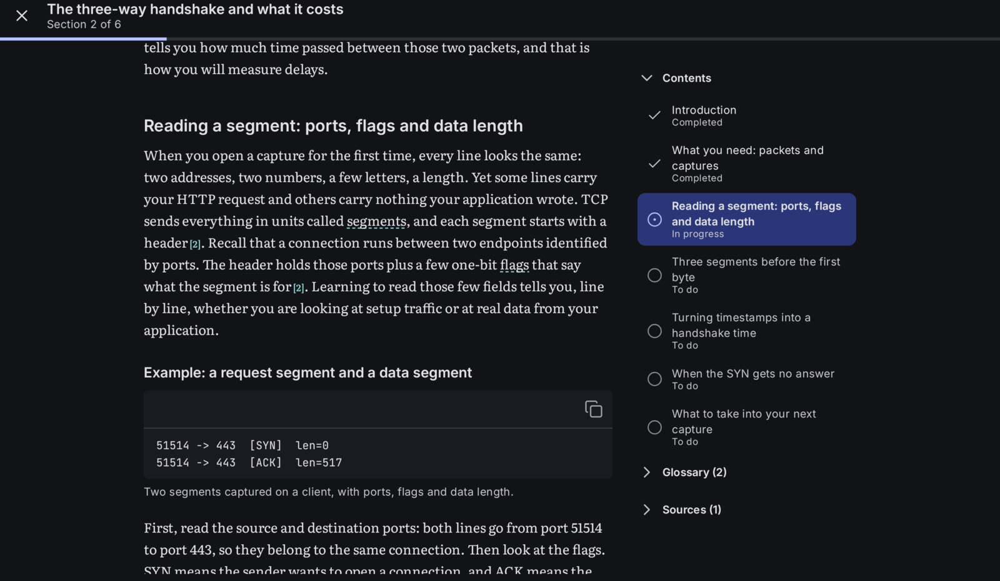
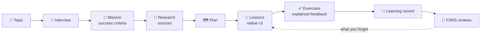
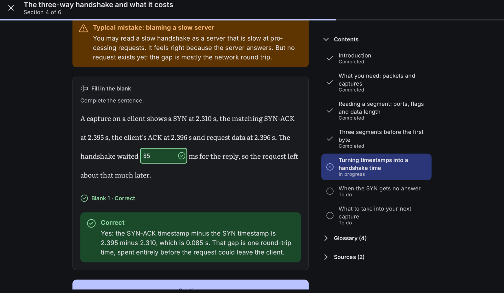
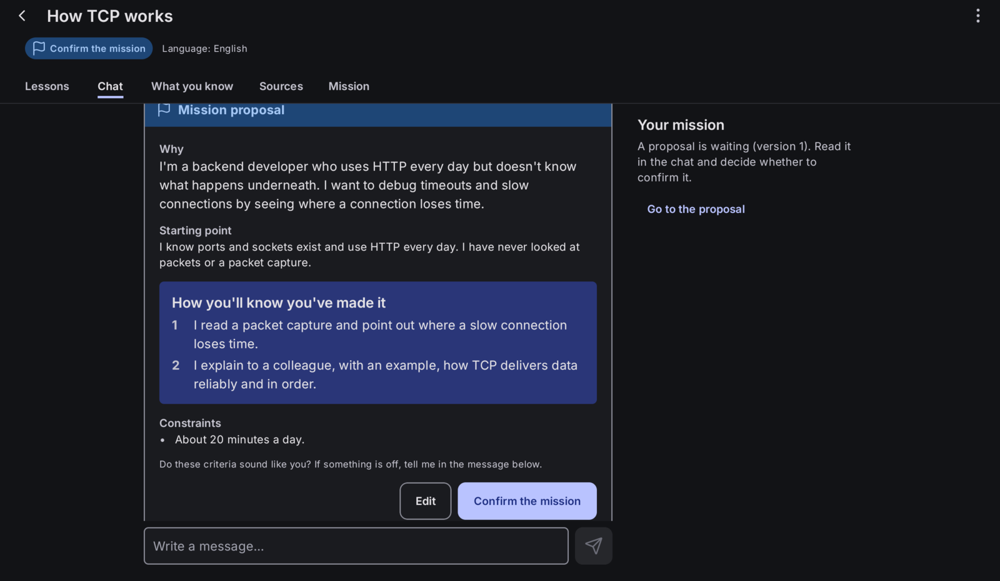
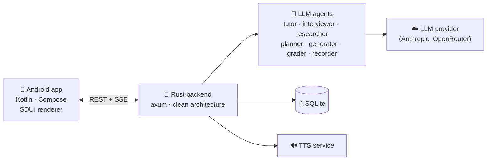

<div align="center">

# teach_me

**Your own AI tutor that agrees on a goal with you, writes the lessons and makes sure you remember them.**

[](https://github.com/francesco-gaglione/teach_me/actions/workflows/ci.yml)
[](LICENSE)




</div>

Pick a topic, any topic. A tutor interviews you about what you already know and why you want to learn it, proposes a **mission** with concrete success criteria, goes looking for sources, and then writes lessons for *you*: not chat replies, but native Android screens with exercises, explained feedback, a glossary and citations. Whatever you learn comes back later as spaced-repetition reviews, so it stays learned.

It runs on your own server, supports several users, and each user brings their own LLM API key.

## How it works



1. **Interview and mission.** The tutor asks where you start from, what you want to be able to do and how much time you have, then proposes a mission you can edit or confirm.
2. **Research and plan.** A researcher agent collects sources (web pages, or PDFs you upload); a planner turns the mission into a sequence of lessons.
3. **Lessons as native UI.** A generator writes each lesson as Server-Driven UI that the app renders with native components; a validator checks it before you ever see it.
4. **Practice.** Exercises are graded with an explanation of *why* you were right or wrong; open answers are graded by an LLM grader.
5. **Remember.** What you have shown you know goes into an evidence-based learning record and comes back as FSRS-7 reviews, with weights tuned to your own answers.

## Features

- 🧩 **Rich lesson blocks**: single and multiple choice quizzes, fill in the blank, order the steps, open answers, flashcards, checklists, code, diagrams, callouts, primary sources, glossary terms.
- 🔁 **Spaced repetition** with FSRS-7, review notifications and per-topic review filters.
- 💬 **Chat with the tutor** about the topic, starting from any lesson or exercise.
- ✍️ **Highlighter and handwriting** on top of the lesson, for a stylus on a tablet.
- 🔊 **Read aloud**, with a self-hosted text-to-speech engine (Qwen3-TTS, CPU only).
- 📄 **Your own sources**: upload PDFs and the lessons cite them.
- 🌍 **Italian and English**, for the interface (follows the device) and for the content (chosen per topic).
- 👥 **Multi-user and self-hosted**: each user's API key is stored encrypted on the server.
- 📱 **Tablet first**: designed for a landscape tablet, works on phones too.

| Exercise with explained feedback | Mission agreed with the tutor |
|---|---|
|  |  |

## Architecture



- **Backend**: a Rust workspace split into `domain`, `application`, `infrastructure` and `api`, with an axum HTTP API, SQLite, a background job runner and Docker deployment. Each agent has its own prompt, structured output and **evaluation suite** that measures the quality of what it produces.
- **Contracts first**: the API and the SDUI schema live in [`docs/contracts/`](docs/contracts/INDEX.md), and both backend and app test against them.
- **App**: Kotlin and Jetpack Compose with its own design system (no Material), built around readability, and a renderer that turns SDUI blocks into native components.

## Built by directing a team of AI agents

Most of the code was written by AI coding agents (Claude Code), directed by me. I acted as product owner and tech lead: I set the scope, made the architectural decisions and reviewed the results, while specialised agents implemented each step.

The process is part of the repository, so you can judge it yourself:

- [`CLAUDE.md`](CLAUDE.md) and [`.claude/agents/`](.claude/agents/) define the team (backend, Android, LLM engineering, learning design, code review, documentation) and the rules for delegating work in short, verifiable steps;
- [`docs/adr/`](docs/adr/README.md) records the decisions and why they were taken;
- [`docs/contracts/`](docs/contracts/INDEX.md) holds the contracts that backend and app both test against;
- every relevant step was reviewed by a separate read-only reviewer agent, and CI runs formatting, lints and the full test suites.

The question behind the project, besides the app itself: how far can a single developer get by running a small team of agents with clear contracts, an explicit architecture and tests as the definition of done?

## Inspiration

The idea comes from Matt Pocock's [`teach` skill](https://github.com/mattpocock/skills/tree/main/skills/productivity/teach), a prompt that turns a coding agent into a tutor: it interviews you, agrees on what you want to learn, and keeps a record of what you have understood. The learning flow and the formats of resources, glossary and learning record follow that skill.

teach_me takes the idea out of the chat and into a full application: specialised agents instead of one prompt, lessons as native screens instead of chat text, spaced repetition so that you keep what you learn, and a self-hosted multi-user server.

## Quick start

**Backend** (needs Rust; the toolchain is pinned in `backend/rust-toolchain.toml`):

```bash
cd backend
export TEACH_ME_SECRET_KEY="$(openssl rand -base64 32)"
cargo run -p api --bin teach-me
```

Then create a user and save their LLM API key (Anthropic) as described in [`backend/README.md`](backend/README.md), which also covers configuration, Docker deployment and backups.

**Android app** (needs JDK 21 and the Android SDK): see [`android/README.md`](android/README.md).

## What is in the repository

| Folder | What |
|---|---|
| [`backend/`](backend/README.md) | Rust workspace, axum, SQLite, job runner, Docker deployment |
| `backend/prompts/`, `backend/evals/` | Agent prompts and the evaluation suites that measure lesson quality |
| [`android/`](android/README.md) | Kotlin + Jetpack Compose app |
| [`docs/`](docs/mvp.md) | Scope (`mvp.md`), decisions (`adr/`), API and SDUI contracts (`contracts/`), visual and interaction design (`design/`) |

The documentation is written in Italian; code, comments and commit messages are in English.

## Credits

- [`teach` skill](https://github.com/mattpocock/skills) by Matt Pocock (MIT): the learning flow and the formats of resources, glossary and learning record.
- [`fsrs`](https://github.com/open-spaced-repetition/fsrs-rs) (BSD-3-Clause) and the FSRS research by the open-spaced-repetition project.
- Read-aloud runs [Qwen3-TTS](https://github.com/QwenLM/Qwen3-TTS) through [qwen3-tts](https://github.com/gabriele-mastrapasqua/qwen3-tts) (MIT); the model is downloaded at first start, not shipped here.
- [PDFium](https://pdfium.googlesource.com/pdfium/) for PDF text extraction, [Lucide](https://lucide.dev) icons (ISC).
- Fonts bundled in the app: [Inter](https://github.com/rsms/inter), [Literata](https://github.com/googlefonts/literata) and [JetBrains Mono](https://github.com/JetBrains/JetBrainsMono), all under the SIL Open Font License 1.1 (license texts in [`licenses/fonts/`](licenses/fonts/)).

## License

Code: [MIT](LICENSE). Bundled fonts: SIL Open Font License 1.1, see [`licenses/fonts/`](licenses/fonts/).
