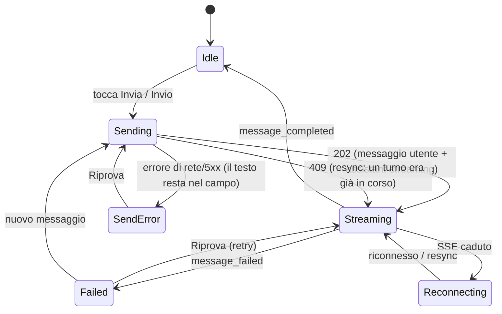

# Schermata Chat con il Tutor (Fase 2)

> Contratto dati: `../../contracts/chat.md`. Vive dentro la schermata Argomento (`topic.md`): non è una schermata a sé, è il **contenuto** dell'Argomento. Componenti: `../base-components.md` (§12 nuovi). Tablet orizzontale per primo (ADR 0003), poi telefono.
> Terminologia: «argomento», «mission» (si spiega la prima volta qui, vedi stato vuoto), «Tutor».

## 1. Scopo didattico

La chat è il luogo dove l'utente **formula il proprio perché** (la mission). Formularlo a parole è già elaborazione attiva: l'interfaccia deve proteggere quel momento, non riempirlo.

- **Carico cognitivo (Sweller)**: una sola conversazione, una sola cosa da fare (rispondere). Nessuna barra laterale che compete: lo spazio in più dell'expanded porta solo *contesto* (la mission), mai altro testo.
- **Leggibilità (Mayer, coerenza)**: il Tutor scrive testo lungo e didattico → si legge come un documento (serif, 600 dp, 17/28), non come una bolla di SMS. Meno inchiostro: i messaggi del Tutor non hanno riquadro.
- **Ritmo dell'utente (segmentazione)**: l'auto-scroll non strappa mai la lettura; durante lo streaming l'inizio del messaggio non esce dallo schermo contro la volontà di chi legge.
- **Errore = occasione**: un messaggio fallito conserva il testo parziale e offre "Riprova", senza colpa e senza perdere il testo dell'utente.

## 2. Layout expanded (tablet orizzontale, riferimento 1280 × 800 dp)

Chat dentro l'Argomento, a tutta finestra (design-system §5.1). In Fase 2 non c'è `TabRow` (una sola tab), quindi dall'alto: TopBar → chip di stato → area chat.

```
|<------------------------------- 1280 dp ------------------------------------>|
┌──────────────────────────────────────────────────────────────────────────────┐
│ ←  Rust                                                                  ⋮   │ TopBar 56, margini 32
│    ( 💬 Definiamo la mission )                                               │ chip, 32 dp dal bordo
├──────────────────────────────────────────────────────────────────────────────┤
│        ┌────────── 600 ──────────┐ 32 ┌──── 280 ────┐                        │
│        │ Tutor                   │    │ La tua       │                        │ gruppo centrato
│        │ Ciao! Perché vuoi       │    │ mission      │                        │ (912 dp)
│        │ imparare Rust?          │    │              │                        │ e scorre con la
│        │          ┌────────────┐ │    │ Ancora da    │                        │ pagina SOLO la
│        │          │ Per lavoro │ │    │ definire.    │                        │ colonna chat;
│        │          └────────────┘ │    │ …            │                        │ il pannello è
│        │ Tutor                   │    └──────────────┘                        │ fisso in alto
│        │ Bene. Che tipo di       │                                            │
│        │ progetti…               │                                            │
│        │      ( ↓ Nuovi messaggi)│                                            │ pillola, 12 dp sopra
│        │ ┌─────────────────┐ [➤]│                                            │ il composer
│        │ │ Scrivi…         │    │                                            │ composer ancorato
│        │ └─────────────────┘    │                                            │ in basso, 600 dp
│        └─────────────────────────┘                                            │
└──────────────────────────────────────────────────────────────────────────────┘
```

Regole:

- **Colonna chat**: larghezza `readingMaxWidth` 600 dp; lista messaggi e composer **hanno la stessa colonna** (stessi bordi sinistro/destro: il campo è allineato al testo che si legge). Scorrimento verticale su *tutta la larghezza* dell'area (la lista riempie la finestra, il contenuto è centrato nella colonna): così la rotellina/trackpad e il tocco nei margini scorrono la chat.
- **Pannello di contesto** (`contextPaneWidth` 280 dp, gap 32 dp dalla colonna, a destra): visibile se la larghezza finestra ≥ **1100 dp**. Gruppo colonna + gap + pannello = 912 dp, **centrato** nell'area; senza pannello (< 1100) la colonna è centrata da sola. Il pannello è **fisso** (non scorre con i messaggi), allineato in alto alla prima riga della lista, senza riquadro: titolo `ui.title3` + testo `ui.body` `inkSoft` su `bg`, separato dalla colonna solo dallo spazio.
  - **Contenuto in Fase 2** (la mission non esiste ancora): titolo «La tua mission»; testo «Ancora da definire. La mission è lo scopo per cui impari «Rust»: guida cosa ti insegno e in che ordine.» (nome dell'argomento interpolato tra «»). Niente altro. Motivazione: pre-training (Mayer), spiegare il termine *a vista* mentre se ne parla; nessuna funzione finta.
  - **Fase 3**: il testo diventa la sintesi della mission (perché, criteri) con «Apri la mission»; contenuto per stato in `mission.md` §4.5.
  - Sotto 1100 dp il pannello **non compare** (in Fase 2 il suo contenuto è già nello stato vuoto e nel dialogo con il Tutor; da Fase 3 diventa un bottone "Mission" che apre un `BottomSheet`).
- **Altezza**: l'area chat riempie il resto fino al fondo della finestra. A 1280 × 800 con tastiera virtuale (~350 dp) restano ≈ 330 dp utili tra chip e composer: lista e composer devono funzionare lo stesso (TopBar + chip **scorrono via** con la lista se l'altezza utile < 480 dp, come in design-system §5.1; il composer resta ancorato sopra la tastiera).
- Margini: `screenMarginExpanded` 32 dp ai lati della finestra (rilevante solo sotto i 1000 dp, dove la colonna si restringe: la colonna è `min(600, larghezza − 2 × margine)`).
- **Medium (600-839)**: come compact con colonna centrata a 600 dp e margini 24; nessun pannello.

## 3. Layout compact (telefono)

```
┌──────────────────────────────────────┐
│ ←  Rust                        ⋮     │  TopBar
│    ( 💬 Definiamo la mission )       │  chip, 16 dp
├──────────────────────────────────────┤
│ Tutor                                │  label ui.labelS inkSoft
│ Ciao! Perché vuoi imparare Rust?     │  reading.body, a tutta larghezza
│                      ┌─────────────┐ │
│                      │ Per lavoro  │ │  utente: accentSoft, max 80%
│                      └─────────────┘ │
│ Tutor                                │
│ Bene. Che tipo di …                  │
│             ( ↓ Nuovi messaggi )     │
├──────────────────────────────────────┤
│ ┌──────────────────────────┐ ┌────┐  │  composer: campo + invio 48 dp
│ │ Scrivi un messaggio…     │ │ ➤  │  │  imePadding
│ └──────────────────────────┘ └────┘  │
└──────────────────────────────────────┘
```

- Margini 16 dp, colonna = larghezza − 32 (≈ 328 dp a 360). La misura è corta (≈ 38-40 caratteri) come per le lezioni: compromesso già accettato in design-system §3.3; i paragrafi del Tutor devono essere brevi (vedi §12).
- **Con la tastiera aperta** (telefono in verticale ≈ 300 dp di tastiera): chip e TopBar scorrono via con la lista; resta visibile il composer e almeno 3 righe di messaggio. `windowSoftInputMode=adjustResize` + `imePadding()` sul contenitore; **`IME_FLAG_NO_EXTRACT_UI`** sul campo (in orizzontale la tastiera non deve diventare a tutto schermo e nascondere la conversazione).
- Telefono in orizzontale: valgono le regole della classe di larghezza (compact/medium): colonna ≤ 600 centrata, nessun pannello.
- **Font ≥ 1,3×**: la bolla utente passa a `max 100%` della colonna (80% di 300 dp sarebbe una colonna di 15 caratteri).

## 4. Lista dei messaggi

Normale `LazyColumn` (non `reverseLayout`: vedi §7), chiave `message.id`, `contentPadding` verticale 16 dp, gap tra messaggi 24 dp (`blockGap`) fra turni diversi, 12 dp (`blockGapTight`) fra messaggi consecutivi dello stesso ruolo.

### 4.1 Messaggio del Tutor (`TutorMessage`)

```
Tutor                                  ← ui.labelS 600, inkSoft; solo sul primo messaggio di una serie
Il **borrow checker** controlla …      ← MarkdownText, reading.body 17/28, ink, su bg (nessun riquadro)
[ blocco codice ]
┬ [ ⎘ ]                                ← footer: IconButton "Copia messaggio" (solo se status = complete)
```

- Nessun riquadro, nessun avatar, nessuna icona decorativa: il Tutor si legge come un documento. Distinzione dall'utente = allineamento + bolla di quest'ultimo + etichetta «Tutor» (non solo colore, P8). Larghezza: piena colonna.
- Tipografia `reading.body` (Literata 400, 17/28); grassetto `reading.bodyStrong`. Stessa tipografia delle lezioni: "ciò che studio" è serif (design-system §3.1), e la chat del Tutor *è* contenuto di studio.
- Footer: un solo `IconButton` (48 × 48 dp, icona `copy` 20 dp `inkMuted`, a sinistra, allineato al margine del testo con offset −12 dp perché l'area tappabile sporga e l'icona sia allineata). Compare solo su messaggi `complete`. Il footer (48 dp) sostituisce il gap di 24 dp che altrimenti seguirebbe il messaggio: dopo il footer segue direttamente il messaggio successivo con 0 dp di gap.
- **Copia**: copia il testo **markdown sorgente** del messaggio (le parti `text` concatenate con riga vuota; le parti native non testuali sono omesse). Su Android ≥ 13 il sistema mostra già la conferma: **nessun toast**; su Android < 13, Toast "Messaggio copiato". Il bottone cambia icona in `check` per 1,5 s e `contentDescription` in "Copiato" (con `liveRegion = Polite`).
- Il testo è **selezionabile** (`SelectionContainer` per messaggio) per copiarne una parte; la selezione ha la barra nativa del sistema.
- Messaggio `streaming`: niente footer; sotto il testo c'è l'indicatore (§6). Messaggio `failed`: niente footer; sotto il testo parziale c'è il pannello di errore (§9).
- Messaggio `complete` **senza parti visibili** (solo parti di tipo sconosciuto; contratto: l'app le ignora): una riga `ui.body` `inkMuted`: «Questo messaggio contiene qualcosa che questa versione dell'app non sa ancora mostrare.»

### 4.2 Messaggio dell'utente (`UserMessage`)

- Bolla allineata a destra: fill `accentSoft`, raggio `md` (10 dp), padding 16 × 12 dp, larghezza max **80%** della colonna (100% con fontScale > 1,3), testo `ui.bodyL` (Inter 400, 16/24) `ink` (contrasto `ink`/`accentSoft` 13,9 light / 8,6 dark). A capo preservati (`\n`), parole lunghe/URL spezzate (`softWrap`), mai ellissi, nessun markdown (il testo utente si mostra **letterale**).
- Sans, non serif: è ciò che l'utente *ha scritto*, non materiale di studio; la differenza di famiglia distingue le due voci anche senza colore.
- Nessuna etichetta visibile ("Tu" solo nella semantica, §11). Nessuna ora per messaggio (rumore); vedi separatore di giorno.
- Copia: pressione lunga (o tasto destro/Maiusc+F10 con tastiera/mouse) → `ActionMenu` con la sola voce «Copia»; stessa azione come `customAction` TalkBack. Testo selezionabile come sopra.

### 4.3 Separatore di giorno (`DaySeparator`)

Quando due messaggi consecutivi cadono in giorni diversi (fuso locale): testo centrato `ui.bodyS` `inkMuted` ("Oggi", "Ieri", "12 novembre", con anno se diverso), margine 24 dp sopra e sotto; heading per TalkBack. Non c'è un separatore prima del primo messaggio. Motivo: orienta (la mission può nascere in più giorni) con pochissimo inchiostro.

### 4.4 Caricamento dei messaggi più vecchi

- Prima pagina: 50 messaggi (default del contratto), mostrati invertiti (il più vecchio in alto). All'apertura la lista salta **in fondo** senza animazione.
- Quando il primo elemento visibile è tra i primi **5** e c'è `next_cursor`: si carica la pagina successiva. In cima alla lista compare una riga (`ui.bodyS` `inkMuted`, spinner 20 dp): «Carico i messaggi precedenti…». I messaggi vengono **anteposti mantenendo l'ancora** sul primo elemento visibile (chiavi stabili: nessun salto; verificare con test). Nessun pulsante "Carica altri" a meno di errore.
- Errore di caricamento della pagina: la riga in cima diventa «Non riesco a caricare i messaggi precedenti.» + Button testuale «Riprova» (48 dp). La lista restante resta usabile; non è un `ErrorState`.
- Finita la cronologia: niente marcatore (la prima riga è semplicemente la prima).
- Caricamento iniziale: skeleton di 3 blocchi (barre `surfaceSunken` 14 dp, raggio `sm`, larghezze 70/100/45%; il secondo allineato a destra e stretto come una bolla), nessuno shimmer, `stateDescription = "Caricamento"`; dopo 8 s «Sto ancora caricando…». Errore del primo caricamento: `ErrorState` (base-components §10.5) con «Riprova».

## 5. Markdown del Tutor

Il parser è **tollerante**: ciò che non è nel sottoinsieme si mostra come **testo letterale** (mai nascosto, mai crash). Il testo è `reading.body` salvo diversa indicazione. Niente HTML. Niente immagini. Niente tabelle strutturate in v1.

| Sintassi | Rendering |
|---|---|
| Paragrafi (righe separate da riga vuota) | `reading.body`; spazio fra paragrafi **12 dp** (`blockGapTight`); un a-capo singolo nel paragrafo = spazio (CommonMark), tranne due spazi finali / `\` = a capo forzato |
| `**grassetto**`, `__grassetto__` | `reading.bodyStrong` (Literata 600). È il solo mezzo di segnalazione (Mayer): non colore |
| `*corsivo*`, `_corsivo_` | Literata italic 400 |
| `***entrambi***` | 600 italic |
| `` `codice inline` `` | `code.inline` (JetBrains Mono 15/28, no ligature), fill `surfaceSunken` (SpanStyle.background), nessun padding verticale (interlinea invariata); testo `ink`. Non va a capo a metà token se non necessario |
| Blocchi recintati ```` ```lang ```` | `CodeBlock` di chat (§5.1) |
| Elenco puntato (`-`, `*`, `+`) | marcatore «•» in `inkSoft`, rientro 24 dp, gap fra voci 6 dp; voce di più righe con rientro appeso (le righe successive allineate al testo, non al marcatore) |
| Elenco numerato (`1.`) | numero in `ui.label`-like Literata 600 `inkSoft` ("1."), colonna di 28 dp allineata a destra, stesso rientro/gap. **Si rispetta il numero di partenza** del sorgente (3. 4. 5.). Max 2 livelli di nidificazione (rientro +24 dp); il terzo livello si appiattisce al secondo |
| Link `[testo](https://…)` | testo in `accent`, **sottolineato sempre** (non solo colore), non va a capo il dominio. Solo `https`. Tocco → apre nel browser di sistema (Custom Tab). Altri schemi (`http`, `javascript:`, `intent:`, `file:`…) o URL non valido → **non** è un link: si mostra il solo testo seguito da l'URL in chiaro tra parentesi. Gli URL "nudi" nel testo **non** diventano link (nessuna auto-linkificazione: l'LLM non decide dove mandare l'utente senza dichiararlo). Il link è esente dal target 48 dp (WCAG 2.5.8, link in linea). TalkBack: azione «Apri collegamento» disponibile sul paragrafo |
| Intestazioni `#`…`####` | **Non** ingrandiscono: si rendono come paragrafo in `reading.bodyStrong` con 16 dp sopra (una chat non è un documento con indice; vedi §12) |
| Citazione `> testo` | letterale (il `>` resta visibile) |
| Linea orizzontale `---` | hairline `line` a tutta colonna, margine 12 dp sopra e sotto |
| Immagine `` | solo il testo `alt` come testo semplice, in corsivo; se vuoto, niente |
| Tabella (righe che iniziano con `\|`) | resa come **blocco di codice** (monospace, scroll orizzontale) così le colonne restano allineate; senza etichetta di linguaggio e senza bottone Copia |
| Escape `\*` | carattere letterale |
| HTML (`<b>`, `<br>`…) | letterale |

### 5.1 Blocco di codice nella chat (`ChatCodeBlock`)

```
┌──────────────────────────────────────────┐
│ rust                              [ ⎘ ]  │  intestazione 48 dp: lingua ui.labelS (codeComment) + IconButton "Copia codice"
├──────────────────────────────────────────┤
│ let s = String::from("ciao");            │  code.block 14/22, codeInk su codeBg
│ let t = s;   // s non è più valido  ▒▒▒▒│  scroll orizzontale; sfumatura 24 dp a destra se c'è overflow
└──────────────────────────────────────────┘
```

- Fill `codeBg`, raggio `sm` (6), padding corpo 12 dp (verticale) × 16 (orizzontale); margine verticale 12 dp. Larghezza: piena colonna. **Nessun a capo automatico**: scroll orizzontale (stesso comportamento del componente `code` delle lezioni), righe numerate **no** (non servono in chat).
- Colori: `codeInk` su `codeBg` (13,3 / 13,1). **In v1 nessuna evidenziazione sintattica** in chat (un testo di dialogo che a volte è colorato e a volte no dà un'illusione di struttura; la sintassi nelle lezioni è un'altra cosa). Se android-dev ha già l'evidenziatore delle lezioni e il linguaggio è noto, può riusarlo: non è richiesto.
- Intestazione: etichetta lingua (se presente nel recinto; altrimenti vuota, intestazione comunque 48 dp perché ospita Copia) a sinistra, `IconButton` «Copia codice» a destra (icona `copy`, 20 dp, `inkSoft`; diventa `check` 1,5 s). Il bottone copia **il solo contenuto del blocco**, non i recinti.
- Il contenitore scorrevole è **focusable** con tastiera fisica (frecce sinistra/destra scorrono di 48 dp, Home/End agli estremi), anello di focus 3 dp.
- Durante lo streaming un recinto non ancora chiuso si renderà già come blocco di codice (aperto): vedi §6.2.
- TalkBack: il blocco è **un solo nodo** con `text` = contenuto del codice e `contentDescription` iniziale «Codice <lingua>» (non uno per riga; il pulsante Copia è un nodo separato).

## 6. Risposta in arrivo e streaming

### 6.1 Prima del primo token

Appena il `POST` risponde `202`, si inserisce il messaggio `assistant` (`status: streaming`, `parts: []`): in lista c'è subito un `TutorMessage` con etichetta «Tutor» e sotto l'**indicatore di attività**:

```
Tutor
● ● ●  Il Tutor sta scrivendo…         ← 3 punti 6 dp, inkMuted; testo ui.bodyS inkSoft
```

- Il **testo c'è sempre** (i punti da soli non dicono nulla ad alcuni utenti e a TalkBack); i punti sono decorativi.
- Animazione: i tre punti **non si muovono**; l'intero gruppo punti oscilla in opacità 0,45 ↔ 1,0 con ciclo di 1600 ms (`inOut`), niente scorrimento né rimbalzo (< 1 Hz, nessun lampeggio). Con "riduci animazioni" (`ANIMATOR_DURATION_SCALE == 0`): opacità fissa 1,0, testo identico.
- Se dopo 20 s ancora nessun token: il testo diventa «Il Tutor ci sta mettendo più del solito…» (nessun pulsante: l'utente non può accelerare niente; l'unica azione è aspettare o uscire, il lavoro continua sul server).

### 6.2 Durante lo streaming

- Il testo cresce nel messaggio. I delta (`message_delta`) si **accumulano in un buffer e si applicano al massimo ogni 100 ms** (≤ 10 aggiornamenti/s), non a ogni token: meno ricomposizione e testo che non "trema". Il testo reso è il parsing markdown dell'accumulato.
- Parsing tollerante di fine testo: marcatori inline non chiusi (`**`, `` ` ``, `[…](`) restano **letterali** finché non si chiudono; un recinto di codice non chiuso è già un `ChatCodeBlock` (senza sfumatura finale); una riga di lista iniziata appare subito come voce. Nessun caso deve causare un'eccezione.
- Sotto il testo, finché `streaming`, resta l'indicatore «Il Tutor sta scrivendo…» (stesso componente, stessa posizione, **sotto l'ultima riga**), per dire "non è finita" senza cursore lampeggiante. Il footer Copia non c'è finché non è `complete`.
- **Fine** (`message_completed`): il contenuto accumulato è **sostituito** da quello definitivo (nessun flash se identico: confronto per uguaglianza), l'indicatore scompare, compare il footer Copia, il composer si riabilita. Annuncio TalkBack: vedi §11.
- Il messaggio parziale non ha mai bordi, lampeggi o colori diversi: non deve sembrare "sbagliato" o "provvisorio" più di quanto serva.

### 6.3 Stato del composer durante un turno

Vedi §8. Il turno è "in corso" se esiste un messaggio `assistant` con `status = streaming` (dal REST, da `message_created` o dalla risposta `202`).



## 7. Scroll

**Layout non invertito.** Non usare `reverseLayout = true`: con il messaggio in crescita in fondo, in un layout invertito il testo che l'utente sta leggendo si sposta verso l'alto quando arrivano token (l'ancora è il fondo). Con layout normale e chiavi stabili il contenuto già letto resta fermo e si decide esplicitamente quando seguire.

Definizioni:
- **In fondo** = il bordo inferiore dell'ultimo elemento dista **≤ 80 dp** dal bordo inferiore dell'area visibile della lista.
- **Messaggio in streaming "ancorato"** = la cima del messaggio in streaming è ancora dentro la lista visibile.

Regole:

1. **Apertura**: salto in fondo, senza animazione.
2. **L'utente invia un messaggio**: la lista va in fondo (anche se era scrollata: è una sua azione). `scrollBy` immediato; animazione 300 ms `out` solo se le animazioni sono attive.
3. **Arrivo di contenuto** (token, nuovo messaggio, completamento):
   - se l'utente è **in fondo** *e* il messaggio in streaming è **ancorato**: segue il fondo, con scroll istantaneo (nessuna `animateScrollTo` a ogni token: salterebbe e farebbe motion sickness);
   - se l'utente è in fondo ma il messaggio in streaming è **più alto dell'area visibile** (la sua cima sta per uscire): **si smette di seguire** nel momento in cui la cima toccherebbe il bordo superiore. L'utente resta all'inizio del messaggio e legge al proprio ritmo (segmentazione, P3); sotto il messaggio continua a crescere. Compare la pillola (punto successivo).
   - se l'utente **non** è in fondo: la posizione non cambia di un pixel; compare la pillola.
4. **Pillola «Nuovi messaggi»** (`NewMessagesPill`, §12): compare quando c'è contenuto nuovo sotto l'area visibile (nuovo messaggio, oppure token arrivati mentre non si segue). Posizione: centrata sulla colonna, 12 dp sopra il composer. Toccandola: scroll in fondo (animato 300 ms o istantaneo con "riduci animazioni"), la pillola scompare e il seguimento riprende (se il messaggio in streaming è ancora più alto dell'area, si va in fondo ma non è richiesto "seguire" oltre la regola 3). Scompare anche da sola quando l'utente arriva in fondo scrollando. Dissolvenza 100 ms. Testo fisso «Nuovi messaggi», icona `arrow-down` a sinistra.
5. **Anteposizione di messaggi vecchi**: l'ancora è il primo elemento visibile; nessun salto.
6. **Cambio di dimensione** (tastiera che appare/scompare, rotazione, split-screen): se l'utente era in fondo, resta in fondo; altrimenti mantiene l'ancora.
7. **Ripresa dell'app** dopo background (nuova sincronizzazione): non si sposta la lista; se sono arrivati messaggi, pillola.
8. **Tastiera fisica**: PagePiù/PagineGiù scorrono di un'altezza utile − 48 dp; Ctrl+Fine va in fondo; frecce ↑↓ di 48 dp (la lista è focusable, §11).

## 8. Composer

```
Compact / expanded (colonna 600):

   (riga motivo, se serve)          ← ui.bodyS inkSoft, icona 16 dp, margine 8 dp sopra il campo
┌───────────────────────────────────┐ ┌────┐
│ Scrivi un messaggio…              │ │ ➤  │   campo: fill surface, bordo border 1,5 dp, raggio sm
└───────────────────────────────────┘ └────┘   invio: 48 × 48 dp
                      0 / 8000 …  (contatore, solo oltre 7000)
```

- **Campo** (`ChatComposer`, specializza `TeachTextField` base-components §2 senza etichetta sopra: qui il placeholder è ammesso perché la funzione è ovvia e `contentDescription`/etichetta semantica «Scrivi un messaggio al Tutor» c'è comunque): multilinea, fill `surface`, bordo `border` 1,5 dp (focus: `focus` 3 dp + offset 2; errore: `danger` 2 dp), raggio `sm`, padding 12 × 12 dp, testo `ui.bodyL` `ink`, placeholder «Scrivi un messaggio…» in `inkMuted`.
  - Altezza: min 48 dp (una riga); cresce con il contenuto fino a **min(40% dell'altezza utile sopra la tastiera, 8 righe)**; oltre scorre dentro il campo (barra di scorrimento nativa). Con font 200% resta valida la percentuale (mai un numero fisso di righe).
  - Tastiera: `KeyboardCapitalization.Sentences`, `autoCorrect` attivo, `imeAction = Default` (a capo) per la tastiera virtuale. `IME_FLAG_NO_EXTRACT_UI`.
- **Pulsante Invia** (`IconButton` 48 × 48 dp accanto al campo, allineato al **fondo** del campo quando è alto; icona `send` 24 dp): primario (fill `accent`, icona `onAccent`) quando può inviare; altrimenti disabilitato (`disabledFill`/`disabledInk`). `contentDescription` «Invia». Distanza dal campo 8 dp. Stato `loading` mentre il POST è in corso: spinner 20 dp, `stateDescription = "In corso"`, campo in sola lettura (il testo non si perde, non si ripete l'invio).
- **Tastiera fisica / hardware**: **Invio** = invia; **Maiusc+Invio** = a capo; **Ctrl+Invio** = invia (sinonimo). Solo per eventi da tastiera fisica (`KeyEvent` con dispositivo non virtuale: `event.device?.isVirtual == false`); la tastiera virtuale mantiene Invio = a capo, l'invio è il bottone (gli utenti con tastiera virtuale in tablet non rischiano un invio accidentale). Se non si può inviare (§ sotto) Invio **non fa nulla** e non inserisce un a capo (altrimenti sembra un invio mancato che sporca il testo): il motivo è già visibile. Tab sposta il focus (non inserisce tabulazioni); Esc con la tastiera virtuale aperta la chiude. Su **attach/detach** di una tastiera fisica non si perde il testo.
- **Quando si può inviare**: il testo, dopo `trim`, ha 1-8000 **caratteri (code point, come il backend)** e nessun turno è in corso (§6.3) e il POST precedente non è in corso.
- **Limite**: 8000. Si può digitare e incollare **oltre** (nessun troncamento silenzioso del testo incollato). Il **contatore** compare solo da 7000: «7 412 / 8000» (`ui.bodyS`, `inkSoft`, allineato a destra sotto il campo, separatore delle migliaia: spazio sottile); oltre il limite il campo passa allo stato errore (bordo `danger` 2 dp, icona `alert-circle` + testo `danger`): «Il messaggio è più lungo di 8000 caratteri: accorcialo di 312.», Invia disabilitato. Contatore `liveRegion = Polite` solo quando si attraversano le soglie 7000 e 8000 (non a ogni tasto).
- **Motivo del blocco** (mai muto, base-components §1):

| Situazione | Riga motivo sopra il campo | Campo | Invia |
|---|---|---|---|
| Idle, campo vuoto | — (il placeholder basta; l'icona Invia ha `contentDescription` «Invia, scrivi prima un messaggio») | attivo | disabilitato |
| Turno in corso (`streaming`) | icona `clock` + «Il Tutor sta rispondendo. Potrai inviare quando ha finito.» | **attivo**: l'utente può preparare la risposta mentre legge (pensare prima di rispondere è un bene); la bozza non si perde | disabilitato |
| Invio in corso | — | sola lettura | spinner |
| Troppo lungo | messaggio d'errore sotto (sopra) | errore | disabilitato |
| Errore di invio | pannello `danger` (§9) | attivo, testo intatto | attivo |

  La riga di motivo non sposta la lista (occupa uno spazio riservato che appare con dissolvenza 100 ms; la lista se in fondo resta in fondo).
- **Bozza**: il testo del composer sopravvive a rotazione, cambio di classe finestra, navigazione avanti/indietro nell'app e processo ucciso (`rememberSaveable` + SavedStateHandle nel ViewModel). Dopo l'invio riuscito il campo si svuota. Non si salva su disco oltre la sessione dell'app.
- Dopo l'invio: il focus resta nel campo con tastiera aperta (si può scrivere subito la risposta successiva; l'invio è disabilitato finché il Tutor non finisce, con il motivo visibile).
- Il composer non compare se il Topic non è raggiungibile (404): vedi topic.md.

## 9. Stato vuoto, errori e casi limite

### 9.1 Stato vuoto (argomento `new`, 0 messaggi)

```
                                             (colonna 600, allineata in alto, 48 dp dalla cima)
Cominciamo da te                              ui.title2
Dimmi perché vuoi imparare «Rust». Il Tutor ti   ui.bodyL, ink, max 600 dp
farà qualche domanda e da lì nascerà la tua
mission: lo scopo che guida ogni lezione.

Per esempio puoi cominciare con:               ui.body, inkSoft
[ Mi serve per il lavoro… ]                    chip-bottoni (secondari, 48 dp) in riga a capo
[ Ho un progetto in mente… ]
[ È per un esame o un corso… ]
```

- **Suggerimenti: sì, tre, come inizi di frase da completare**, non risposte pronte. Motivazione: la pagina bianca è un freno (carico cognitivo), ma una risposta pronta toglierebbe all'utente la formulazione del proprio perché (effetto di generazione, Bjork: scrivere con parole proprie rafforza e produce una mission più specifica). Per questo i chip **non inviano**: inseriscono il testo nel composer con il cursore **in fondo**, aprono la tastiera e lasciano continuare («Mi serve per il lavoro…» → l'utente scrive il resto).
- Chip: `Button` secondario (base-components §1) con etichetta `ui.label`, a capo se serve (mai ellissi), altezza min 48, gap 8 dp, in `FlowRow`. Sono `Role.Button`. Spariscono (dissolvenza 100 ms) appena il campo contiene del testo qualsiasi e non tornano; sono sotto al testo, quindi non spostano nulla.
- Il composer è attivo e in basso come sempre. **Focus**: con tastiera fisica collegata, il composer prende il focus all'apertura (si può scrivere subito); con tastiera virtuale **non** si apre la tastiera da sola (coprirebbe metà dello stato vuoto): la apre il tocco sul campo o su un chip.
- Il pannello di contesto (expanded) dice «Ancora da definire» (§2).
- Il nome dell'argomento in «» come in design-system §11; se molto lungo, a capo, mai troncato.
- Il testo non promette: non dice "in pochi minuti" né nomina funzioni che non ci sono ancora.

### 9.2 Messaggio `failed` (`ChatErrorPanel`)

```
Tutor
Le ownership di Rust funzionano così: ogni valo      ← testo parziale, invariato
┌──────────────────────────────────────────────────┐
│ (!) Risposta interrotta                          │  StatusPanel danger (icona alert-circle)
│ Il servizio del modello non ha risposto. Quello  │  corpo ui.bodyL, ink su dangerSoft
│ che vedi sopra è ciò che era arrivato.           │  (omettere questa frase se non c'è testo parziale)
│ [ ↻ Riprova ]                                    │  Button secondario 48 dp, solo sull'ULTIMO messaggio
└──────────────────────────────────────────────────┘
```

- **Fase 11**: con `error.code` = `llm_key_missing` / `llm_key_rejected` il panel è `LlmKeyNotice` (`../llm-key.md` §6), senza «Riprova» finché la chiave non cambia; con `llm_credit_exhausted` è `LlmKeyNotice` `credit` **con «Riprova»** e senza rimando alle Impostazioni (`../llm-key.md` §9.3). Con chiave nota come mancante o rifiutata, sopra il composer c'è un suggerimento non bloccante (`../llm-key.md` §4.2); il composer resta attivo.
- Il panel è in seguito al testo (contiguità), a 12 dp, larghezza della colonna.
- Titolo/corpo per `error.code`:

| Codice | Titolo | Corpo |
|---|---|---|
| `upstream_failed` | «Risposta interrotta» | «Il servizio del modello non ha risposto. Riprova tra poco.» |
| `rate_limited` | «Troppe richieste» | «Il servizio del modello è occupato. Aspetta un minuto e riprova.» |
| `internal` (anche dopo riavvio) | «Risposta interrotta» | «Qualcosa è andato storto sul server. Riprova.» |
| altro/sconosciuto | «Risposta interrotta» | «Non sono riuscito a completare la risposta. Riprova.» |

  Con testo parziale si aggiunge in coda: «Sopra c'è la parte arrivata prima dell'interruzione.» Mai il campo `error.message` grezzo in primo piano (può essere tecnico/inglese); si può mostrare in un "Dettagli" testuale espandibile (`ui.bodyS`, `inkSoft`), come per i job di lezione.
- **Riprova**: solo se il messaggio fallito è l'ultimo del Topic (come il contratto; altrimenti `409`). Premuto: `loading` («Riprovo…»), `POST …/retry` → `202`: **il testo parziale sparisce** (il backend azzera `parts`), il messaggio torna a `streaming` con l'indicatore di §6.1. Se la lista era in fondo, resta in fondo.
- Messaggio `failed` **non ultimo** (l'utente ha scritto dopo): niente "Riprova"; il panel diventa corpo-soltanto «Questa risposta non è stata completata.» (sobrio, non ci si può far nulla).
- Un messaggio `failed` non impedisce di scrivere: il composer resta attivo (l'utente può riformulare). **Aperto** per il backend: cosa vede il modello dei messaggi `failed` nella cronologia.
- Annuncio: vedi §11.

### 9.3 Errore di invio (POST fallito)

Pannello `danger` **sopra il composer** (non nella lista: il messaggio non è stato creato): titolo «Messaggio non inviato», corpo «Non sono riuscito a raggiungere il backend. Il tuo testo è ancora nel campo.» + Button secondario «Riprova» che rimanda lo stesso testo; chiusura con ✕ (IconButton 48 dp «Chiudi»). Per `5xx`/`internal`: «Il server ha avuto un problema. Il tuo testo è ancora nel campo.» Un `401` non si mostra qui: si apre l'accesso (`login.md`). Per `409 llm_key_missing` e `502 llm_key_rejected`: `LlmKeyNotice` (`../llm-key.md` §5), nello stesso posto; per `502 llm_credit_exhausted`: `LlmKeyNotice` `credit` con «Riprova» che rinvia il testo del campo (`../llm-key.md` §9.2); il testo resta nel campo. Nessun messaggio utente "fantasma" in lista: l'inserimento in lista avviene solo con la risposta `202` (deduplicato per `id` con l'evento SSE `message_created`).

### 9.4 `409 conflict` all'invio

Può accadere se un altro client ha avviato un turno, o se lo stato locale è vecchio. Comportamento: il testo **resta** nel campo; si ricarica la cronologia via REST (silenzioso, senza spostare la lista); appare il messaggio in streaming; il composer entra nello stato «Il Tutor sta rispondendo…» di §8. Se dopo la ricarica non c'è nessun turno in corso (si è chiuso nel frattempo), riga di motivo `info`: «La chat si è aggiornata. Controlla il messaggio e invia di nuovo.» (l'utente deve vedere cosa è arrivato prima di rispondere). Nessun toast di errore.

### 9.5 `409` al "Riprova"

Lo stato è cambiato altrove (già ritentato, o c'è un messaggio più recente): silenziosa ricarica via REST; Toast «La chat si è aggiornata.»; il pulsante sparisce se il messaggio non è più ultimo/fallito.

### 9.6 Rete caduta durante lo streaming

Il backend **continua a generare** anche se l'app si disconnette (contratto §2): l'utente non ha perso nulla.

- Subito: il testo già arrivato resta. L'indicatore sotto il messaggio cambia, senza panico: icona `wifi-off` 16 dp + «Connessione persa. Riconnetto…» (`ui.bodyS`, `inkSoft`; senza colore d'allarme). Il composer resta nello stato «turno in corso».
- Riconnessione automatica con backoff del contratto (1, 2, 5, poi 10 s) con `Last-Event-ID`: se il buffer c'è, i delta mancanti arrivano e l'indicatore torna «Il Tutor sta scrivendo…»; se arriva `resync_required` si ricaricano messaggi e Topic via REST, **senza spostare la lista** (§7.7) e senza flash (si sostituiscono per `id`).
- Dopo **30 s** senza riuscire: sotto il messaggio, «Non riesco a raggiungere il backend. La risposta continua a prepararsi sul server e la ritroverai qui.» + Button testuale «Riprova ora» (forza un tentativo). Nessun `danger`: non è una risposta fallita.
- Se la connessione ritorna e il messaggio è nel frattempo `complete`: il testo viene sostituito dal definitivo (nessuna notifica speciale), annuncio di §11.
- Se non c'è un turno in corso, la perdita dello stream è **invisibile** (riconnessione silenziosa); si vede solo se si tenta di inviare (§9.3).
- Offline all'apertura: la cronologia già caricata non è in cache in Fase 2 → `ErrorState` del primo caricamento. (Se in futuro c'è cache: mostrare i messaggi e un banner.)

### 9.7 Topic eliminato / 404

Come `topic.md`: ritorno alla Cartella con Toast «Questo argomento non esiste più.» (la bozza si perde: è accettato).

## 10. Posto per la card nativa di proposta della mission (Fase 3)

> **Specifica completa in `mission.md`** (anatomia, stati, streaming, accessibilità). Valgono qui le regole di inserimento sotto. Correzioni: il pannello di contesto da Fase 3 ha il contenuto di `mission.md` §4.5; sotto 1100 dp **non** c'è un BottomSheet «Mission» ma la tab Mission (`mission.md` §4.1); i bottoni della card sono disabilitati (con motivo) mentre un turno è in corso; la card resta confermabile anche dopo che l'utente ha scritto (finché non arriva una nuova bozza).

La card **non si disegna ora**. Si inserirà come **parte** (`{"type": "mission_proposal", …}`) del messaggio `assistant`, quindi dentro il `TutorMessage` e non come elemento separato della lista: il renderer di un messaggio itera le `parts` **in ordine** e per ognuna sceglie il composable (`text` → `MarkdownText`; `mission_proposal` → la card; tipo sconosciuto → saltato). Ordine, gap e footer sono già quelli giusti: la card è un blocco di larghezza piena colonna dopo il testo del Tutor, con gap 12 dp, **fuori** dal `SelectionContainer`; il footer Copia ignora le parti non testuali (§4.1). Poiché le parti native arrivano intere (non token per token), durante lo streaming la card compare quando la sua parte è completa e **non** causa rimescolamenti del testo sopra. Lo stato della card (proposta attiva / confermata / sostituita da una nuova proposta) si deriva dallo stato del Topic e dal messaggio più recente, non da un flag nel testo; il composer **resta attivo** accanto alla card, perché discutere la proposta a parole deve essere sempre possibile quanto premere «Conferma». Il pannello di contesto (expanded) mostrerà la sintesi della mission una volta confermata; prima della conferma riflette la bozza se esiste. Chip di stato: `mission_proposed` → «Conferma la mission» (topic.md) senza altre modifiche alla chat. Dettagli visivi, bottoni e semantica (annuncio «Mission proposta», `Role.Button`) nella specifica della Fase 3.

### 10.1 «Punto di partenza» nella card in chat (v1.2, Fase 12)

Specifica completa in `mission.md` §2.5; qui solo ciò che riguarda la chat.

- **Posizione**: nella card, tra «Perché» e il blocco dei criteri. Ordine: banda → Perché → **Punto di partenza** → criteri → vincoli → fuori ambito → domanda → azioni. Motivo didattico: i criteri si giudicano alla luce di ciò che già so; il blocco `accentSoft` dei criteri resta l'unico elemento evidenziato.
- **Resa**: etichetta «Punto di partenza» (`ui.label` `inkSoft`, heading livello 3) e testo in prosa `ui.body` `ink`, fino a 600 caratteri (≈ 9 righe a 600 dp di colonna). **Mai troncato** nella bozza aperta e nella proposta di modifica: è parte di ciò che l'utente valuta, come i criteri. Nessun markdown, nessun punto elenco. Fuori dal `SelectionContainer` come il resto della card.
- **Card confermata**: la sezione non compare (resta ripiegata come vincoli e fuori ambito). **Card sostituita**: compare solo nell'espansione «Mostra questa versione», in sola lettura.
- **`null` o chiave assente nello snapshot** (messaggi precedenti alla v1.2): la sezione non compare e **non c'è nessun invito** nella card (l'invito esiste solo nella tab Mission, `mission.md` §4.6).
- **Proposta di modifica**: se il punto di partenza è nuovo o cambiato rispetto alla versione `replaces_version`, pill «Nuovo» accanto all'etichetta; se cambiato (non solo aggiunto), sotto il testo `Disclosure` chiuso «Com'era nella versione 2» con il testo precedente.
- **Auto-scroll all'arrivo** (`mission.md` §2.4): invariato; la card è più alta di ≈ 9 righe nel caso peggiore, la regola «bordo superiore della card allineato in alto» resta valida.
- **Composer**: «Modifica» e la card non cambiano; il placeholder specifico del punto di partenza si usa solo dall'invito della tab Mission.
- **TalkBack**: il testo è un solo nodo dopo l'heading; «, nuovo» in coda all'etichetta se c'è la pill. Ordine di lettura nella card come in `mission.md` §6.

## 10b. Card della lezione richiesta (`LessonRequestCard`, issue 17)

> Contratto: `../../contracts/lessons.md` §12 (parte `lesson_request`, ammissibilità), §4 (step del job). Specifica gemella della card della mission (§10, `mission.md` §2). Riferimento: tablet orizzontale; poi compact.

### 10b.1 Scopo didattico

L'utente chiede la prossima lezione a parole («ok, passiamo alla prossima») e il Tutor la mette in coda. La card è **il ponte tra la conversazione e l'azione**: dice che cosa sta succedendo e, a lezione pronta, porta alla lezione in **un solo tocco**.

- **Carico cognitivo, coerenza (Mayer)**: la card mostra **una riga** di stato, non la lista di 4 fasi della tab Lezioni (`topic.md` F3.C). In chat l'attenzione deve restare sul dialogo; la lista completa è un secondo luogo per lo stesso job e raddoppierebbe l'inchiostro.
- **Un'azione sola per stato** (Hick): in coda/in corso nessuna; pronta «Apri lezione»; fallita «Riprova». Mai due bottoni.
- **Niente pressione** (P9): nessun conto alla rovescia, nessuna stima di minuti, nessun «ti stiamo aspettando». Si può uscire: la lezione si prepara sul server.
- **È un riferimento, non uno snapshot**: lo stato si legge dal job (`job_id`), non dal testo del messaggio; se la card viene riletta giorni dopo mostra l'esito vero.

### 10b.2 Inserimento

Come la card della mission (§10): **parte** `lesson_request` del `TutorMessage` (sempre l'ultima), blocco a tutta larghezza di colonna, gap 12 dp dal testo sopra, **fuori** dal `SelectionContainer`, ignorata dal footer «Copia». Il composer **resta attivo** (si può continuare a parlare col Tutor mentre la lezione si prepara). Un messaggio ha al più una card. Tipo di parte sconosciuto: saltato (regola di §10).

Compare quando la sua parte è completa (a `message_completed`/`message_failed`, quindi dopo il testo, senza rimescolare nulla). **Auto-scroll all'arrivo**: come la card della mission (`mission.md` §2.4, bordo superiore della card allineato in alto, solo se l'utente era in fondo; altrimenti pillola «Nuovi messaggi»). I **cambi di stato successivi non scrollano mai** la lista e non fanno comparire la pillola: l'altezza cambia al massimo di una riga o due; se l'utente è in fondo resta in fondo (regola `AtBottomThreshold` di §7).

### 10b.3 Anatomia e stati

Riusa `StatusPanel` (`base-components.md` §5) con una riga di azione sotto (stesso schema di `topic.md` F3.D); nessun componente nuovo salvo il frame, che è `StatusPanel` + slot azione. Nessuna ombra, nessun bordo aggiunto, solo `feedbackAppear` (200 ms) tra stati, sostituzione immediata con «riduci animazioni».

| Stato | Quando (job) | Variante | Contenuto | Azione |
|---|---|---|---|---|
| **In coda** | `queued` | `StatusPanel progress` (fill `surfaceSunken`, spinner 24 `accent`) | titolo `ui.labelL` `ink` «Sto preparando la lezione»; sotto, `ui.body` `inkSoft` «In coda…» | nessuna |
| **In corso** | `running` | `progress` | stesso titolo; sotto, **solo la riga dello step corrente** `ui.body` `ink`: `planning` «Scelgo cosa insegnare» · `writing` «Scrivo la lezione» · `checking` «Controllo la lezione» · `saving` «Salvo la lezione» | nessuna |
| **In correzione** | `running`, `step == writing` con `done` > 1 (o `message` «Correggo la lezione») | `progress` | riga «Correggo la lezione» + `ui.bodyS` `inkSoft` «Ho trovato qualcosa da sistemare e lo sto sistemando.» Nessun numero di tentativi, nessun colore d'allarme (`topic.md` F3.C) | nessuna |
| **Step sconosciuto** | `running` con step non riconosciuto | `progress` | spinner + `progress.message` (se assente: «Sto preparando la lezione…») | nessuna |
| **Pronta** | `succeeded` | `StatusPanel correct` (icona `check-circle`, `correct` su `correctSoft`) | titolo «Lezione 3 pronta» (numero da `result.lesson_number`); se il titolo della lezione è già nella lista delle lezioni: `ui.body` `ink` sotto il titolo (altrimenti omesso, mai un segnaposto) | **primario** (48 dp) «Apri lezione», icona `arrow-right` |
| **Fallita, ultimo job** | `failed` e job = ultimo `lesson_generation` del Topic | `StatusPanel danger` (icona `alert-circle`) | titolo e corpo della tabella `topic.md` F3.D per `error.code` (stessi testi, nessuna copia nuova). **Senza** `Disclosure` «Dettagli» (sta nella tab Lezioni). Chiavi LLM (`llm_key_missing`, `llm_key_rejected`, `llm_credit_exhausted`): al posto del pannello il `LlmKeyNotice` di `../llm-key.md`, con le stesse regole di «Riprova» di F3.D | secondario «Riprova» (icona `rotate-ccw`) |
| **Fallita, non ultimo** | `failed`, esiste un job `lesson_generation` più recente | `danger` | titolo «Preparazione non riuscita»; corpo «Dopo questa ne hai chiesta un'altra: la trovi nella tab Lezioni.» | **nessuna** |
| **Sconosciuto / non caricato** | il `job_id` non è nella lista job caricata (pagine vecchie), job di tipo imprevisto o `status` sconosciuto | `Surface static` (fill `surface`, bordo `line` 1 dp, raggio `md`, padding 16) | icona `book-open` 20 `inkMuted` + «Richiesta di una lezione» `ui.label` `inkSoft`. Nessuno spinner, nessun errore, nessun skeleton (potrebbe non risolversi mai) | **nessuna** |

Contrasti: tutti da `StatusPanel` e `design-system.md` §2.4 (`correct`/`correctSoft`, `danger`/`dangerSoft`, corpo `ink` ≥ 7:1, `inkSoft`/`surfaceSunken` 8,15 / 11,30); `inkMuted` su `surface` solo per l'icona decorativa dello stato sconosciuto (il testo è `inkSoft`). **Nessun nuovo colore.** Stato = icona + parole, mai solo colore.

**Transizioni**: quando il job cambia stato la card cambia **sul posto** (dissolvenza `fast`); il dato arriva da `job_updated` e, al ritorno in primo piano, dal ricaricamento della lista job. Il passaggio da «sconosciuto» a uno stato noto avviene con la stessa dissolvenza, senza scatto di scroll. A differenza di F3.C non c'è la chiusura di 600 ms delle fasi: la card passa direttamente a «Pronta» (una riga sola non ha fasi da chiudere).

**Riprova**: `POST /topics/{id}/jobs/{job_id}/retry`; mentre parte, il bottone è `loading` «Riprovo…» (`busy`); riuscito → la **stessa** card torna «In coda» (stesso `job_id`). Rete caduta: sopra il bottone riga `ui.bodyS` `inkSoft` «Non sono riuscito a raggiungere il backend. Controlla la connessione.» (live region Polite). `409`: ricarica in silenzio e ricalcola (può essere diventata «non ultimo» o in corso).

**Card duplicate**: se il Tutor cita lo stesso job in due messaggi (caso «già in preparazione», `lessons.md` §12) le due card mostrano lo stesso stato. Gli annunci e il toast sono **una volta per job**, sulla card più recente.

**Toast di F3.C**: il Toast «La lezione 3 è pronta» (`topic.md` F3.C) **non compare** se l'utente è nella tab Chat con una card di quel job nella lista caricata (la card è già l'avviso, e un secondo avviso sarebbe rumore). Resta valido nelle altre tab.

**Chip di stato del Topic**: invariato (`ready`), come in F1.

### 10b.4 Layout

**Expanded (≥ 840 dp, tablet orizzontale; colonna chat 600 dp, con o senza `ContextPane`)**: contenuto a sinistra, azione a destra sulla stessa riga, allineata al centro verticale.

```
|<---------------- 600 dp (colonna chat) ---------------->|
 Il Tutor: Va bene, preparo la prossima lezione…         (testo, §4.1)
 12 dp
┌───────────────────────────────────────────────────────┐ StatusPanel, raggio md, padding 16
│ (✓)  Lezione 3 pronta                  ┌────────────┐ │ icona 24 + ui.labelL correct
│      Lifetimes in pratica              │ Apri lezione →│ │ titolo lezione ui.body ink · Button primario 48, min 160
│                                        └────────────┘ │
└───────────────────────────────────────────────────────┘
┌───────────────────────────────────────────────────────┐
│ ◌  Sto preparando la lezione                           │ stato in corso: nessun bottone
│    Scrivo la lezione                                    │ ui.body ink
└───────────────────────────────────────────────────────┘
```

**Compact (< 840 dp) e font oltre 1,3×**: colonna `min(600, w − 2·margine)`, il bottone va **sotto**, a tutta larghezza (48 dp, gap 12). Stesse parole.

```
┌─────────────────────────────┐
│ (✓)  Lezione 3 pronta       │
│      Lifetimes in pratica   │
│ ┌─────────────────────────┐ │
│ │      Apri lezione   →   │ │ 48 dp, fillMaxWidth
│ └─────────────────────────┘ │
└─────────────────────────────┘
```

Nessuna altezza fissa; a 200 % il titolo e il testo vanno a capo, il bottone resta intero (mai ellissi). Il `ContextPane` (≥ 1100 dp) **non cambia** per la card (resta la sintesi della mission): niente link duplicato di «Apri lezione» nel pannello.

### 10b.5 Dove porta «Apri lezione»

Stessa destinazione in tutti i layout: la **schermata Lezione** (`lesson.md`) di `result.lesson_id`, a tutta finestra (nessun pannello, colonna 600), alla posizione salvata se già iniziata. Non cambia tab: l'utente non passa dalla tab Lezioni (un tocco, non due: ogni passaggio in più tra la richiesta e la lezione è attrito che fa perdere l'attimo di motivazione). L'uscita ✕ / Indietro di sistema (`lesson.md` §6, «Uscita») riporta all'Argomento sulla **tab Chat**, con lo stesso scroll e la card nello stesso punto; il composer conserva la bozza. Aperta la lezione, la pill «Nuova» sulla sua riga nella tab Lezioni si spegne come se la tab fosse stata visitata (`topic.md` F3.C). Errore nel caricare la lezione: Toast «Non riesco ad aprire la lezione. Controlla la connessione.» e la card resta com'è.

### 10b.6 Accessibilità

- **Struttura**: la card è un gruppo con `paneTitle` «Preparazione di una lezione»; icona/spinner decorativi (`contentDescription` nulla, il significato è nel testo); titolo = heading di livello 3; ordine di lettura: titolo → riga di stato/titolo lezione → bottone. Stato in lettura continua: `stateDescription` «In corso» sul gruppo mentre `queued`/`running`.
- **Annunci (live region `Polite` persistente di §11, un nodo solo, mai più di uno per transizione)**:
  - alla chiusura del messaggio che contiene la card: «Il Tutor ha avviato la preparazione di una lezione.» al posto di «Il Tutor ha risposto.» (se la card è già «Pronta» o «Fallita», lo stato corrente al posto della frase);
  - cambio di step: «Preparo la lezione: scrivo.» (verbo per step: «scelgo cosa insegnare», «scrivo», «controllo», «salvo»; in correzione «correggo»), coalescenza 1 s, solo i **cambi di step**, non `progress.message`;
  - pronta: «Lezione 3 pronta. Apri lezione disponibile.»;
  - fallita con Riprova: «Preparazione interrotta. Riprova disponibile.»; senza: «Preparazione non riuscita.»;
  - stato sconosciuto: nessun annuncio; caricamento della cronologia: nessun annuncio (si annuncia solo ciò che cambia **mentre** l'utente è nella schermata).
- **Focus**: l'app **non sposta mai** il focus di TalkBack (regola di §11). Su «Riprova» premuto il focus resta sul bottone (che diventa «Riprovo…»). Su «Apri lezione» il focus passa alla schermata Lezione come per ogni navigazione; al ritorno torna al bottone della card.
- **Bottoni**: etichetta visibile e nome coerenti (WCAG 2.5.3): «Apri lezione» → `contentDescription` «Apri lezione 3: Lifetimes in pratica» (senza titolo: «Apri lezione 3»); «Riprova» → «Riprova a preparare la lezione». Loading: `stateDescription` «In corso». Target 48 dp, anello di focus 3 dp, Invio/Spazio attivano; Tab: dopo l'ultimo nodo di testo del messaggio, prima del messaggio successivo.
- **Non solo colore**: stato = icona + parola (spinner/«Sto preparando…», check/«pronta», alert/«non riuscita»). Dark e light dai token; font 200 %: vedi §10b.4.

### 10b.7 Cosa non fare

Elenco delle fasi in chat; percentuale o barra di avanzamento; stima di minuti; animazione celebrativa a lezione pronta; due bottoni (es. «Apri lezione» + «Vai alle lezioni»); bottone «Riprova» su job non ultimo; messaggio d'errore tecnico (`error.message` crudo); card che scompare quando lo stato è sconosciuto; spinner infinito per uno stato non caricato.

### 10b.8 Costanti

`LessonRequestStackMaxWidth = 840.dp` (sotto: bottone sotto il testo) · `LessonRequestStackFontScale = 1.3f` · `LessonRequestStepCoalesceMs = 1000` · `LessonRequestPadding = 16.dp`.

## 11. Accessibilità

- **Ordine di lettura (TalkBack / focus)**: Indietro → titolo (heading) → «Altre azioni» → chip («Stato: definiamo la mission») → **lista messaggi** in ordine cronologico (alto→basso) → pillola «Nuovi messaggi» (se presente) → riga motivo/errore del composer → campo → Invia → pannello di contesto (ultimo: è secondario; usare `traversalIndex`). Il pannello ha `Modifier.semantics { heading() }` sul titolo.
- **Messaggi**: ogni **blocco** (paragrafo, voce di elenco, blocco di codice, footer) è un nodo a sé — non un unico nodo per l'intero messaggio, così TalkBack naviga per paragrafo. Il primo nodo di un messaggio del Tutor è l'etichetta «Tutor» (heading di livello basso). Il messaggio utente è **un solo nodo**: «Tu: <testo>». I separatori di giorno sono heading.
- **Streaming e TalkBack**: **nessuna live region sul testo in arrivo** (non si annuncia ogni token né ogni frase). Il nodo del messaggio in streaming espone `stateDescription = "In scrittura"` e il testo corrente, consultabile a mano. All'invio la live region (`Polite`, invisibile, nodo unico persistente) annuncia **una volta**: «Il Tutor sta scrivendo.» A `message_completed`: «Il Tutor ha risposto.» (senza leggere il testo: l'utente lo naviga quando vuole; mantiene il controllo del ritmo). A `message_failed`: «Risposta interrotta. Riprova disponibile.» Alla perdita connessione: nessun annuncio immediato; alla soglia dei 30 s, l'annuncio del testo di §9.6 (Polite). Il **focus di TalkBack non viene mai spostato** dall'app.
- **Composer**: il campo ha `contentDescription`/etichetta «Scrivi un messaggio al Tutor»; Invia: «Invia» (disabilitato: stato `disabled`, la riga motivo è un nodo letto subito prima del campo). Il contatore parla solo alle soglie (§8).
- **Pillola**: `Role.Button`, «Nuovi messaggi», `liveRegion Polite` alla comparsa.
- **Copia**: «Copia messaggio» / «Copia codice»; dopo la copia «Copiato» (Polite). Azioni personalizzate sui messaggi: «Copia» (utente e Tutor), «Apri collegamento» (se contiene link).
- **Font 200%**: nessuna altezza fissa; bolla utente 100% oltre 1,3×; composer: altezza proporzionale alla finestra (§8); intestazione del `ChatCodeBlock` a capo l'etichetta lingua se serve; chip di suggerimento in colonna, uno per riga, oltre 1,3×. Il testo del Tutor a 200% a 328 dp è ≈ 20 caratteri per riga: è un limite noto dello schermo piccolo, non si riduce l'interlinea; sul tablet (600 dp) rimane ≈ 35. Con 200% su compact il pannello di errore e le azioni vanno in colonna.
- **Tastiera fisica** (tablet con Bluetooth): Tab/Maiusc+Tab attraversano i controlli nell'ordine sopra; anello di focus 3 dp ovunque (Copia, Riprova, pillola, code block, link). Le frecce ↑/↓ sulla lista scorrono di 48 dp; PagSu/PagGiù di una pagina − 48 dp; Ctrl+Fine in fondo; **nel campo** le frecce muovono il cursore (non la lista). Enter/Space attivano il controllo focalizzato; Invio nel composer invia (§8). Tutto è eseguibile senza mouse.
- **Contrasti** (calcolati): `ink`/`accentSoft` (bolla utente) 13,92 light / 8,60 dark; `inkSoft`/`accentSoft` 7,59 / 6,48; `inkMuted`/`bg` (punti, ora, placeholder) 6,25 / 7,51; `accent`/`bg` (link) 7,32 / 10,89; `border`/`surface` (bordo del campo) 4,08 / 5,16; `codeInk`/`codeBg` 13,30 / 13,08; `codeComment`/`codeBg` (etichetta lingua) 5,44 / 6,77. Il resto da design-system §2.4.
- **Non solo colore**: ruolo = allineamento + etichetta «Tutor» + famiglia tipografica; link = sottolineatura; errore = icona + titolo + testo; connessione persa = icona + testo.

## 12. Indicazioni per il Generator/Tutor (da passare a llm-engineer)

Il Tutor non genera blocchi SDUI ma **testo markdown** per questo schermo. Per rispettare lettura e carico cognitivo:

1. **Una domanda per messaggio** (due solo se la seconda è una precisazione della prima). Termina con la domanda, non con convenevoli.
2. **Paragrafi brevi** (≤ 3-4 frasi, ≈ 60 parole); un'idea per paragrafo; al massimo ~150 parole per messaggio nell'intervista; quando insegna più lungo ma a blocchi.
3. **Niente intestazioni** (`#`), tabelle, citazioni `>`, immagini, HTML, URL nudi. Link solo `https` nel formato `[testo](url)` e solo se servono.
4. Grassetto per **al massimo 1-3 termini chiave** per messaggio (segnalazione); corsivo con parsimonia; niente maiuscole per enfasi, niente emoji decorative.
5. Elenchi solo per sequenze o insiemi reali (≤ 5 voci, una riga ciascuna); numerati solo se l'ordine conta.
6. Codice: inline per identificatori, blocchi recintati con **linguaggio** (```rust) per più righe; righe ≤ 60 caratteri (scroll orizzontale esiste ma non si legge bene); mai codice per decorare.
7. Spiegare «mission» la prima volta che si usa il termine (la schermata lo fa anche nello stato vuoto, ma il Tutor non deve darlo per scontato).
8. Tono: seconda persona informale, sobrio; niente «Bravo!» generico, niente punti esclamativi su un errore, niente «Ottima domanda!». Una conferma è specifica.
9. Non ripetere nella risposta ciò che l'utente ha appena detto (a parte una riformulazione di una riga se serve a verificare di aver capito).
10. Prima di proporre la mission, il Tutor riassume in 2-3 righe cosa ha capito e chiede conferma a parole se manca qualcosa (la card di Fase 3 arriva dopo).
11. **Lezione richiesta (§10b)**: se la persona chiede la prossima lezione, il Tutor scrive **una frase** prima della card («Preparo la prossima lezione.») e chiama `request_lesson`; non descrive le fasi, non promette tempi, non ripete «Lezione pronta» (lo dice la card). Se la lezione è già in preparazione lo dice («Ce n'è già una in preparazione») senza richiamare il tool a vuoto. Se il Topic non è pronto spiega che cosa manca (mission da confermare, ricerca in corso) in una frase. Se esiste una lezione non ancora chiusa, può ricordarlo in una frase (i record nascono alla chiusura: `topic.md` F3.B), ma se la persona insiste la richiede comunque (autonomia).

## 13. Costanti (non in `tokens.json`; metterle in codice con questi nomi)

`ChatMaxChars = 8000` · `ChatCounterThreshold = 7000` · `UserBubbleMaxFraction = 0.8` (1.0 se fontScale > 1,3) · `ComposerMaxHeightFraction = 0.4` · `ComposerMaxLines = 8` · `AtBottomThreshold = 80.dp` · `StreamApplyIntervalMs = 100` · `PrefetchOlderIndex = 5` · `ContextPaneMinWindow = 1100.dp` · `StreamSlowHintMs = 20_000` · `ReconnectHintMs = 30_000` · `PulseCycleMs = 1600` (opacità 0,45-1,0).

## Aggiunte del tech lead (implementazione Fase 2)

- Riprova fallito per rete: toast "Non sono riuscito a riprovare. Controlla la connessione." (il messaggio resta `failed` con il suo pannello).
- Lo stream si considera caduto dopo 45 s senza dati né ping (3 heartbeat persi) e si riconnette: per l'utente vale lo stato "Connessione persa. Riconnetto…".
- Il messaggio dell'utente non è selezionabile: la pressione lunga apre "Copia". I link si aprono con il browser di sistema.
