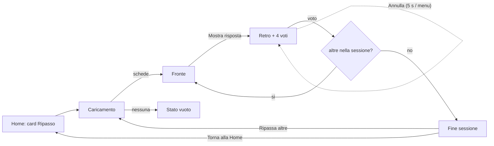

# Schermata Ripasso (Fase 8)

> Completa la bozza di Fase 0. Contratto: `../../contracts/reviews.md` (vincolante: `ReviewCard`, `DueReviews`, voto con `review_count`, annulla entro 10 minuti, sospendi). Componenti: `../base-components.md` (TopBar §6, Button §1, Progress §9, ConfirmDialog §8, ActionMenu §10.2, Skeleton §10.4, ErrorState §10.5, Popover come in `lesson.md` §8.1). Modello della scheda: `../components/flashcard.md` (stesso aspetto e stessi voti). Principi: `../design-system.md` §1 (P1-P13). Riferimento di progetto: **expanded 1280 × 800 dp** (ADR 0003); poi medium e compact.
> **Nessun token nuovo.** Un solo elemento nuovo, `UndoRow` (§5), composto con token esistenti.

## 1. Scopo didattico

Allenare il **richiamo a intervalli crescenti** (spacing effect e retrieval practice: Bjork; Roediger e Karpicke). Tre cose guidano ogni scelta:

1. **Il tentativo mentale viene prima della rivelazione** (P5). Il fronte non offre aiuti, il retro compare solo per scelta dell'utente.
2. **L'autovalutazione deve essere onesta** (calibrazione metacognitiva). Per questo i quattro voti sono identici per stile (P7: nessun voto "spinto" da colore, peso o posizione di favore) e le parole descrivono l'*esperienza di richiamo*, non un giudizio.
3. **Nessuna pressione** (P9): niente timer, serie, punteggi, percentuali, conteggio degli errori, celebrazioni, suoni. Una sessione ha una dimensione **finita e piccola** (20 schede, §7).

## 2. Flusso



La schermata si apre **a tutta finestra** su ogni classe (non è un pannello del list-detail: `design-system.md` §5.1, "l'attività di studio occupa la finestra"). Indietro/✕ torna a Home, che si ricarica in `ON_START`.

## 3. Misure comuni

| Elemento | Valore |
|---|---|
| Colonna | `readingMaxWidth` 600 dp, centrata. Sotto 600 dp di finestra: tutta la larghezza meno margini |
| Margini schermo | expanded 32, medium 24, compact 16 |
| TopBar | `TopBar` 56 dp: `x` "Chiudi il ripasso" · titolo «Ripasso» (`ui.title2`; con sessione filtrata «Ripasso · Rust», §7.3) · [indicatore coda `cloud-off`, solo se serve §8] · `more-vertical` "Altre azioni" (menu §6). Su expanded la TopBar occupa tutta la larghezza, il contenuto sotto resta nella colonna |
| Riga avanzamento | sotto la TopBar, nella colonna: altezza 28 dp; a sinistra «3 di 12» (`ui.body` `inkSoft`, `tabular-nums`), sotto una `ProgressBar` 4 dp (traccia `line`, riempimento `accent`, animazione `progress` 300 ms). È avanzamento *di sessione*, non un obiettivo: non cambia colore, non si completa con effetti |
| `UndoRow` | 56 dp riservati sotto la riga avanzamento (§5): niente salti di layout quando compare |
| Scheda (`Surface` statica) | fill `surface`, bordo `line` 1 dp, raggio `md`, nessuna ombra. Padding 24 (expanded), 20 (medium), 16 (compact). Altezza min 200 dp (expanded/medium), 160 (compact) |
| Gap | `UndoRow` → scheda 8 dp; scheda → pulsante / voti 16 dp (24 in expanded) |
| Posizione verticale | la scheda parte **sempre dallo stesso y** (subito sotto `UndoRow`), non è centrata in verticale: il passaggio fronte → retro cresce verso il basso, niente salti |
| Contrasti | `ink`/`surface` 16,0+ / 14,4+; `inkSoft`/`surface` 9,35 / 10,08; `inkSoft`/`bg` 8,97 / 10,88 (tutti già calcolati in `design-system.md` §2.4, AAA) |

## 4. Fronte, rivelazione, retro

### 4.1 Layout expanded (1280 × 800, riferimento)

```
┌──────────────────────────────────────────────────────────────────────────────────────────┐
│ ✕   Ripasso                                                            (cloud-off)   ⋮   │ TopBar 56, a tutta larghezza
├──────────────────────────────────────────────────────────────────────────────────────────┤
│                         ┌── colonna 600 dp, centrata ──┐                                 │
│                         │ 3 di 12                      │                                 │ riga avanzamento
│                         │ ▓▓▓░░░░░░░░░                 │ ProgressBar 4 dp
│                         │  (UndoRow: vuota, 56 dp)     │
│                         │ ┌──────────────────────────┐ │
│                         │ │ Rust                     │ │ caption argomento: ui.label ink (+ icona per «term»), §4.2
│                         │ │                          │ │
│                         │ │ Quando compila           │ │ front: reading.cardFront (Literata 500 24/34) ink
│                         │ │ l'operatore `?` dentro   │ │
│                         │ │ una funzione?            │ │
│                         │ │                          │ │
│                         │ │ Prova a ricordare prima  │ │ ui.body inkSoft (solo 1a scheda della sessione)
│                         │ │ di guardare la risposta. │ │
│                         │ └──────────────────────────┘ │
│                         │ [      Mostra risposta     ] │ Button PRIMARIO grande 56, largo come la colonna (KeyHint «Spazio»)
│                         └──────────────────────────────┘ │
└──────────────────────────────────────────────────────────────────────────────────────────┘
```

Retro (stessa colonna, stesso y della scheda; il pulsante «Mostra risposta» è sostituito dai voti):

```
│                         │ 3 di 12                      │
│                         │ ▓▓▓░░░░░░░░░                 │
│                         │ ┌──────────────────────────┐ │
│                         │ │ Rust                     │ │ caption argomento (come sul fronte)
│                         │ │ Quando compila l'op…     │ │ front ridotto: reading.body 17/28 inkSoft, max 3 righe + «…»
│                         │ │ ──────────────────────── │ │ hairline line
│                         │ │ Solo se il tipo di       │ │ back: reading.cardFront 24/34 ink
│                         │ │ ritorno può contenere    │ │ (reading.body 17/28 se > 200 caratteri)
│                         │ │ l'errore, per esempio    │ │
│                         │ │ `Result<T, E>`.          │ │
│                         │ │ ⓘ Apri la lezione        │ │ azione (solo se lesson_id ≠ null), §4.2: label accent, target ≥ 48
│                         │ │   Lezione 2 · Result e…  │ │ ui.bodyS inkSoft, parte dello stesso target
│                         │ └──────────────────────────┘ │
│                         │ Quanto ti è venuta in mente? │ ui.label ink (titolo del gruppo)
│                         │ ┌───────┐┌───────┐┌───────┐┌───────┐
│                         │ │Non la ││Con    ││Bene   ││Facilis││ 4 Button secondari IDENTICI, in riga (144 dp l'uno,
│                         │ │ricord.││fatica ││       ││sima   ││ gap 8), min 64, altezza uguale per tutti
│                         │ │tra 10 ││tra 2  ││tra 5  ││tra 11 ││ riga 2: intervallo (ui.bodyS inkSoft)
│                         │ │minuti ││giorni ││giorni ││giorni ││
│                         │ └───────┘└───────┘└───────┘└───────┘
```

### 4.2 Contenuto della scheda

| Elemento | Regola |
|---|---|
| Caption dell'argomento (fronte e retro) | **Provenienza = solo l'argomento** (decisione del proprietario: niente cartella). Prima riga della scheda, identica su fronte e retro, sempre nello stesso punto. `topic_title` in **`ui.label`** (Inter 600 14/20) **`ink`** (16,0:1 chiaro / 14,4:1 scuro su `surface`): era `ui.bodyS` `inkSoft` (12/16, peso 400), troppo discreta per dire «da dove viene» a colpo d'occhio. Un colore d'accento non serve: peso + `ink` bastano, e `accent` è riservato alle azioni (P2). Una riga, `maxLines` 1 con ellissi oltre la larghezza utile (il titolo completo è nel nodo a11y); a font ≥ 150% può andare a capo (max 2 righe). Se `kind = term`: icona `book-open` 16 `knowledge` a sinistra + «Rust · Parola del glossario» (stesso stile, il suffisso in `ui.labelS` `inkSoft`). Con `kind = record` o sconosciuto: solo il titolo, senza icona. L'argomento sul fronte non rivela la risposta: l'utente sa già cosa sta ripassando (P5, P7 non toccati: nessun titolo di lezione) |
| Etichetta «Da consolidare» | Solo se `to_consolidate = true` (`reviews.md` §1.3). **Fronte e retro**, stessa posizione: riga propria **sotto la caption**, gap 8 dp, allineata a sinistra, sopra `front`. Così la scheda non salta alla rivelazione e non compete con la caption di `kind = term` (le due convivono: la caption resta la prima riga, l'etichetta la seconda; nessuna delle due va a capo dentro l'altra). Aspetto: pillola non interattiva, altezza visiva 28 dp, raggio `full`, padding 4 × 12 dp (`spacing.sm`), fill `surfaceSunken`, **nessun bordo**, icona `repeat` (Lucide) 16 dp + testo `ui.labelS`, entrambi `inkSoft` (contrasto 8,1:1 chiaro, 11,3:1 scuro). Testo esatto: **«Da consolidare»**. Niente colori di esito (né `danger` né `warning`), niente punto esclamativo, niente conteggio. Sul fronte non rivela la risposta e dice solo «questo punto vale la pena riprenderlo» (P5, P7 non toccati). Nessun tocco, nessun popover, nessun target nuovo (P1). Quando la scheda smette di esserlo (due voti buoni di fila, `reviews.md` §1.3) la pillola **non si anima**: alla prossima apertura non c'è più. Dopo il voto che la promuove, la scheda corrente non cambia e la `UndoRow` non ne parla |
| Origine e «Apri la lezione» | **Solo sul retro**, in fondo alla scheda, sopra il padding inferiore, gap 12 dp dal `back`. **Mai sul fronte**: un titolo di lezione può essere un indizio della risposta (P5, P7). Vedi §4.6 per l'azione. Con `lesson_id = null` (lezione eliminata o scheda senza lezione): **nessuna azione**; se `lesson_number` e `lesson_title` ci sono, restano come riga di testo non interattiva (`ui.bodyS` `inkSoft`, «Lezione 2 · Result e operatore ?»), altrimenti la riga non c'è |
| `front`/`back` | md inline (`sdui.md` §3): `code.inline`, grassetto (`reading.bodyStrong`). Niente blocchi di codice. Termini del glossario nel `back` **non** tappabili (nel ripasso un secondo target dentro il testo distrae dal voto) |
| Suggerimento «Prova a ricordare…» | solo sulla **prima scheda di ogni sessione**: ripeterlo ogni volta diventa rumore (P2) e si abitua l'occhio a ignorarlo |
| Testo lungo | la scheda cresce; la colonna scorre. A 200% di font la scheda può superare lo schermo: voti e pulsante restano **sotto** la scheda nel flusso di scroll, tranne in compact (§9) |

### 4.3 Rivelazione

- Solo con tocco su «Mostra risposta», **Spazio** o **Invio**. Nessun timer, nessuna rivelazione automatica.
- Transizione `cardReveal`: dissolvenza incrociata 150 ms, senza flip 3D né slide (P7, vestibolare). Con «riduci animazioni»: istantanea.
- Il pulsante «Mostra risposta» è l'**unico primario** della schermata mentre si vede il fronte (non è un voto: non può indirizzare l'autovalutazione). Sul retro non c'è nessun primario: i quattro voti sono tutti secondari.
- Dopo la rivelazione il **focus** va al titolo «Quanto ti è venuta in mente?» e il retro è annunciato (§10). La scheda **non si può "ri-nascondere"**: tornare al fronte non ha scopo.
- Uscita dal retro **solo** con un voto (o ✕). Nessun «Salta»: una scheda "saltata" resta in scadenza e riappare, quindi non cambia nulla; saltare incoraggerebbe l'evitamento delle schede difficili. Se la scheda non ha più senso: «Sospendi» (§6).

### 4.4 Voti

| Elemento | Valore |
|---|---|
| Ordine fisso | **«Non la ricordavo»** (`again`) · **«Con fatica»** (`hard`) · **«Bene»** (`good`) · **«Facilissima»** (`easy`). Peggiore → migliore, sinistra → destra (expanded/medium) o a Z (2×2) |
| Stile | 4 Button **secondari identici**: fill `surface`, bordo `border` 1,5 dp, raggio `md`, testo `ui.label` `ink`; nessun rosso/verde, nessuna icona diversa, nessuna enfasi. Pressed `surfacePressed`; focus anello 3 dp |
| Contenuto | riga 1: etichetta (`ui.label` `ink`, a capo se serve, centrata); riga 2: intervallo in parole (`ui.bodyS` `inkSoft`, centrato). Padding 12 × 12 dp |
| Altezza | min 64 dp; **i quattro hanno la stessa altezza** (la maggiore della riga/griglia, `IntrinsicSize.Max`) |
| Disposizione | expanded e medium: **1 riga da 4** (larghezza uguale, gap 8), finché fontScale ≤ 1,3; fontScale 1,3-1,8: 2×2; > 1,8: colonna. Compact: **2×2** finché fontScale ≤ 1,3, poi colonna. Anche in colonna l'ordine resta peggiore → migliore dall'alto |
| Tastiera fisica | `KeyHint` 24 × 24 con la cifra (1-4) a sinistra dell'etichetta, solo se c'è una tastiera fisica (`_exercises.md` §6) |
| Dopo il tocco | i bottoni diventano disabili e la scheda successiva entra (nessuno stato "selezionato" intermedio: un tocco = un voto, §5) |

**Perché mostrare gli intervalli sotto i voti.** Rendono trasparente la conseguenza del voto («se non ricordo la rivedo presto, va bene») e riducono l'ansia da "voto sbagliato". Rischio noto: l'utente potrebbe votare per ottenere l'intervallo che preferisce; lo mitiga il fatto che i testi sono neutri e che il voto onesto è il più conveniente (l'intervallo giusto arriva da lì). Il backend non usa fuzz: ciò che si legge è ciò che accade.

### 4.5 Formattazione degli intervalli (secondi → parole)

Input: `intervals_preview.{again,hard,good,easy}` in secondi (interi). Uscita: sempre «tra …», minuscolo, mai abbreviazioni ("min", "gg", "h"). L'arrotondamento è al più vicino; dopo l'arrotondamento, se il valore raggiunge l'unità successiva si passa a quella (59,6 minuti → «tra 1 ora»).

| Secondi `s` | Regola | Esempi |
|---|---|---|
| `s` < 60 | «tra 1 minuto» (mai secondi) | 20 → «tra 1 minuto» |
| 60 ≤ `s` < 3600 | `m = round(s/60)`; se `m` = 60 → «tra 1 ora»; altrimenti «tra m minuti» (m = 1: «tra 1 minuto») | 600 → «tra 10 minuti»; 90 → «tra 2 minuti» |
| 3600 ≤ `s` < 86 400 | `h = round(s/3600)`; se `h` = 24 → «tra 1 giorno»; altrimenti «tra h ore» (h = 1: «tra 1 ora») | 18 000 → «tra 5 ore» |
| `d = s/86 400` < 30 | `n = round(d)`; se `n` ≥ 30 → regola dei mesi; altrimenti «tra n giorni» (n = 1: «tra 1 giorno») | 172 800 → «tra 2 giorni»; 950 400 → «tra 11 giorni»; 129 600 (1,5 d) → «tra 2 giorni» |
| 30 ≤ `d` < 365 | `mo = round(d/30,4375)` (minimo 1); se `mo` ≥ 12 → regola degli anni; altrimenti «tra mo mesi» (1: «tra 1 mese») | 5 184 000 (60 d) → «tra 2 mesi»; 31 d → «tra 1 mese» |
| `d` ≥ 365 | `y = round(d/365,25)` (minimo 1): «tra y anni» (1: «tra 1 anno») | 400 d → «tra 1 anno» |
| `s` ≤ 0 o campo mancante | **non si scrive nulla** sotto l'etichetta (la riga 2 sparisce) e la `contentDescription` omette l'intervallo | — |

Implementazione: una sola funzione pura `formatInterval(seconds: Long): String` con test per ogni riga della tabella (compresi i bordi 59/60 s, 3599/3600, 86 399/86 400, 29,5 d, 364 d). Stesso testo in `contentDescription`. Le stringhe usano plurali di Android (`plurals`), non concatenazioni.

**Prossima scadenza (`next_due_at`) in parole** (fine sessione, Home): `delta = next_due_at − adesso` (orologio dell'app; l'errore di qualche minuto non conta). Nell'ordine:
- `delta` < 60 min → la regola degli intervalli («tra 10 minuti»);
- stesso giorno di calendario locale → «oggi alle 18:30» (formato 24 h);
- il giorno dopo → «domani»;
- da 2 a 6 giorni → il nome del giorno («venerdì»);
- da 7 in poi → «il 24 novembre».

La frase che lo usa è sempre «La prossima scheda arriva {x}.» («La prossima scheda arriva domani.», «… arriva tra 10 minuti.», «… arriva il 24 novembre.»).

### 4.6 «Apri la lezione» (solo retro)

Perché: una scheda dimenticata spesso si capisce solo rivedendo il contesto in cui è nata (codifica specifica del contesto, Tulving). Va **dopo** la rivelazione e il tentativo di richiamo: il retro è già visibile, quindi non c'è nulla da sbirciare (P5 rispettato). Non si vota in automatico e non si presume che aprirla significhi «non la ricordavo»: l'autovalutazione resta onesta (P7).

| Aspetto | Specifica |
|---|---|
| Componente | `Button` **testuale** (base-components §1), **un solo target** largo come la scheda (area tappabile = l'intera riga, altezza min **48 dp**, 2 righe, padding 8 × 0, allineata a sinistra). Nessun fill, nessun bordo; focus: anello 3 dp; pressed: fill `accentSoft` |
| Contenuto | Riga 1: icona `book-open` 20 `accent` + «**Apri la lezione**» (`ui.label` `accent`; `accent`/`surface` ≥ 4,5:1, già verificato in `topic.md` F6). Riga 2, sotto il testo (non sotto l'icona): «Lezione 2 · Result e operatore ?» in `ui.bodyS` `inkSoft` (a capo liberamente, mai ellissi a font 200%). La riga 2 dà a chi vede *quale* lezione si aprirà: è la vecchia riga di origine, ora parte dell'azione |
| Gerarchia | Non è un voto né un primario: sta **dentro la scheda**, i quattro voti restano gli unici controlli di peso. Nessun colore di esito, nessun badge |
| Comportamento | Tocco → la lezione `lesson_id` si apre **sopra il ripasso** a tutta finestra, come il ripasso si apre sopra Home (stessa transizione di navigazione standard, nessun token nuovo). Nessuna chiamata a `/reviews`. L'app **non** scrive alcun voto. La sessione (indice, schede, retro rivelato, `UndoRow` attiva) resta in memoria e sopravvive a rotazione e a kill del processo come già la sessione (`SavedStateHandle`) |
| Ritorno | **Indietro** (gesto, ✕ della lezione, Alt+←) dalla lezione riporta **alla stessa scheda, ancora sul retro**, con lo scroll di prima; il focus va su «Apri la lezione» e non si annuncia nulla di nuovo. Nessuna scheda avanzata, nessun voto dato. Se nel frattempo l'`UndoRow` era in finestra, il suo timer continua a scorrere in background (scade a 10 minuti dal voto come da contratto, non dalla visita) |
| Lezione non apribile | Errore della schermata lezione (`lesson.md`), con Indietro che riporta al retro. Se `404` (lezione eliminata nel frattempo): la lezione mostra il suo stato di errore standard; tornati al ripasso, la scheda perde l'azione (come `lesson_id = null`) senza altri messaggi |
| Dalla lezione si può ripassare? | No: dentro la lezione aperta dal ripasso non compaiono scorciatoie al ripasso; si torna solo con Indietro |
| Tastiera fisica | **Alt+L** = «Apri la lezione» (solo sul retro e solo se l'azione c'è). Non confligge con 1-4, Spazio, Invio, Ctrl+Z, Esc, Alt+←. Niente lettera singola: i tasti semplici restano liberi per i voti. Con tastiera fisica collegata, `KeyHint` «Alt+L» 24 dp a destra del testo (come i voti, §4.4) |
| TalkBack | `Role.Button`, `contentDescription` «Apri la lezione 2, Result e operatore ?. Si apre sopra il ripasso e poi torni a questa scheda.» (la seconda frase solo la prima volta della sessione, poi si accorcia). Ordine: dopo il testo del `back`, **prima** del gruppo «Quanto ti è venuta in mente?» |

## 5. Dopo il voto: annulla (`UndoRow`)

Un tocco su un voto lo applica subito; per 5 secondi lo si può annullare con un tocco (poi resta la voce del menu, §6). Dopo il tocco:

1. Il voto viene applicato **in modo ottimistico**: non si aspetta il backend. Entra nella coda locale (§8) e parte la richiesta.
2. Compare `UndoRow` e, con `screenEnter` (300 ms, dissolvenza), la scheda successiva. Se era l'ultima, §7.
3. Dopo 5 s `UndoRow` si dissolve (150 ms). Con servizi di accessibilità attivi dura `AccessibilityManager.getRecommendedTimeoutMillis(5000, CONTROLS|TEXT)`, non meno di 5 s.

```
┌──────────────────────────────────────────────┐
│ Bene: la rivedrai tra 3 giorni.     [Annulla]│  UndoRow: 56 dp riservati sempre, contenuto solo per 5 s
└──────────────────────────────────────────────┘
```

| Elemento | Valore |
|---|---|
| Perché non un Toast | Il Toast di base (`base-components.md` §9) è in basso e coprirebbe i voti o il pulsante ancorato; in alto coprirebbe la domanda. Una **riga riservata** nel flusso non copre nulla né sposta il contenuto. Stessa durata richiesta (5 s) e stessi colori |
| Aspetto | nessun fill (testo su `bg`); testo `ui.body` `inkSoft`, fino a 2 righe; Button testuale «Annulla» (48 dp, `accent`) a destra. Nessuna icona, nessun colore di esito |
| Testo | «{Voto}: la rivedrai {intervallo}.» con {Voto} = «Non la ricordavo» · «Con fatica» · «Bene» · «Facilissima» e {intervallo} = lo stesso testo mostrato sul bottone («tra 10 minuti»), es. «Non la ricordavo: la rivedrai tra 10 minuti.» |
| Live region | `Polite`, annuncia il testo all'apparire; l'azione «Annulla» è raggiungibile con TalkBack nell'ordine dopo la scheda |
| Annulla | tocco su «Annulla», **Ctrl+Z**, o voce del menu ⋮ «Annulla l'ultimo voto» (§6) |

**Che cosa fa «Annulla»**
- Voto **ancora nella coda locale** (non inviato): si rimuove dalla coda, nessuna richiesta.
- Voto già inviato: `POST /reviews/{id}/undo`. Con `200` si usa la scheda restituita (con `intervals_preview` ricalcolati e `review_count` precedente).
- L'app torna **alla scheda annullata, già sul retro** (la risposta è stata vista: rifare il fronte falserebbe il richiamo), con i quattro voti disponibili. La scheda successiva torna in testa alla coda di sessione; il contatore torna a «3 di 12»; `UndoRow` si svuota.
- Solo **l'ultimo** voto è annullabile (come il contratto). Se l'utente ha già dato un altro voto, la riga mostra solo l'ultimo.
- `409` (più di 10 minuti o nessun voto): `UndoRow` mostra per 4 s «Non si può più annullare questo voto.», senza azione. Rete assente (richiesta non partita): «Non riesco ad annullare ora. Controlla la connessione.» (4 s, senza azione); il voto resta applicato.

## 6. Menu ⋮ (azioni della scheda)

`ActionMenu` (§10.2), ancorato al `more-vertical` della TopBar; disponibile su fronte e retro. Voci (max 4, 48 dp):

| Voce | Icona | Quando | Effetto |
|---|---|---|---|
| **Annulla l'ultimo voto** | `rotate-ccw` | solo se esiste un ultimo voto della sessione e `now − reviewed_at` ≤ 10 min | come «Annulla» (§5). Serve quando i 5 s sono scaduti: l'errore di tocco si scopre spesso dopo |
| **Sospendi questa scheda** | `pause` | sempre | `ConfirmDialog` (sotto) |

Niente «Modifica scheda», «Elimina scheda», «Segnala»: fuori contratto (`reviews.md` §7).

### 6.1 Sospendi

Va confermata (tocco accidentale nel menu; i dati non si perdono). Si può **riattivare** da Impostazioni › Schede sospese (`suspended.md`, `reviews.md` §3.2): il corpo del dialog lo dice, così la scelta non pesa come irreversibile. `ConfirmDialog` (§8, `dialogWidth` 360 compact / 480 medium-expanded; focus iniziale su «Annulla»):

| Elemento | Testo |
|---|---|
| Titolo | Sospendere questa scheda? |
| Corpo | Non la rivedrai nel ripasso finché non la riattivi da Impostazioni › Schede sospese. Il registro e il glossario restano come sono. |
| Conferma (Button primario, non distruttivo: non si perdono dati) | Sospendi la scheda · in corso: «Sospendo…» |
| Annulla | Annulla |

- Successo (`200`): dialog chiuso, la scheda esce dalla sessione (il totale scende di 1: «4 di 11»; se era l'ultima, §7), `UndoRow` per 6 s (testo più lungo): «Scheda sospesa. La riattivi da Impostazioni › Schede sospese.» (senza «Annulla»: l'azione sta nella lista, `suspended.md`; la riga resta di testo semplice). Annuncio Polite «Scheda sospesa».
- Errore (rete, `5xx`): il dialog resta aperto con `StatusPanel danger` (live region): «Non riesco a raggiungere il backend» / «La scheda non è stata sospesa. Riprova quando sei di nuovo collegato.» La sospensione **non** si mette in coda offline (azione rara e deliberata, serve l'esito certo).
- `404` (scheda eliminata altrove): trattata come successo, senza testo.
- Sospendere non registra un voto e non influisce sul contatore delle schede ripassate.

## 7. Sessione, arretrato e fine

**Dimensione della sessione: 20 schede** (`limit=20`, ordinate per `due` crescente: prima le più in ritardo).

Perché 20 e non "tutte":
- circa 5 minuti (15 s a scheda, la stima del contratto): una pausa, non un compito; si inizia più volentieri (P9, motivazione intrinseca);
- l'**affaticamento** peggiora la qualità dell'autovalutazione: dopo molte schede si vota per liberarsi, non per ricordare, e FSRS riceve segnali falsati (il valore dello spacing sta nella fedeltà del voto);
- un contatore enorme («87 da fare») produce evitamento; una sessione finita dà una **fine certa** (effetto Zeigarnik inverso: chiudere un ciclo riduce il carico aperto);
- chi vuole di più può continuare (sotto), senza che l'app lo spinga.

Regole:
- All'apertura: `GET /reviews/due?limit=20`. Le schede della sessione sono quelle `items`; N = `items.length`. La sessione **non** ricarica altre pagine (`next_cursor` si ignora).
- **Niente ripresentazione nella stessa sessione**: una scheda votata «Non la ricordavo» ha l'intervallo breve (es. 10 minuti) e torna *dopo*, non subito (ripresentarla subito è richiamo a breve termine, non memoria).
- **Ripasso anticipato**: non esiste in v1 (si ripassa solo ciò che è in scadenza).
- A fine sessione: si svuota la coda dei voti (max 3 s di attesa) e `GET /reviews/due?limit=1` per `due_count` e `next_due_at`. Il numero di «altre» schede = `due_count` meno i voti locali ancora in coda.
- Uscire a metà (✕, Indietro, Alt+←): **nessuna conferma**, i voti dati sono salvati, il resto resta in scadenza. Non c'è «Sessione interrotta».

### 7.1 Fine sessione (nessun arretrato)

```
┌─────────────────────── colonna 600 ───────────────────────┐
│                                                            │
│  Ripasso finito                                            │ ui.title1 ink, heading, focus iniziale
│  Hai ripassato 12 schede.                                  │ ui.bodyL ink
│                                                            │
│  Le rivedrai a breve                                       │ ui.label ink   (solo se ci sono schede «Non la ricordavo»)
│  · Quando compila l'operatore `?` dentro…   tra 10 minuti  │ ui.body ink, 2 righe max + «…»; intervallo ui.bodyS inkSoft
│  · Borrowing mutabile                       tra 10 minuti  │ max 5 righe, poi «e altre 2»
│                                                            │
│  La prossima scheda arriva domani.                         │ ui.body inkSoft
│                                                            │
│  [          Torna alla Home          ]                     │ Button primario grande 56
└────────────────────────────────────────────────────────────┘
```

| Elemento | Regola |
|---|---|
| Titolo | «Ripasso finito» |
| Conteggio | «Hai ripassato N schede.» (N = voti applicati, annullati esclusi; 1: «Hai ripassato 1 scheda.»). Non è un punteggio: dice cosa si è fatto, non quanto bene |
| Elenco «Le rivedrai a breve» | **solo** le schede il cui voto finale è «Non la ricordavo» (intervallo breve). Mostra il testo del `front` e l'intervallo applicato. Non ha un'intestazione numerica ("3 errori"), niente colore, niente icona di esito: è un'informazione utile (che cosa tornerà) non una colpa. Righe non tappabili. Se nessuna: l'elenco non c'è. Le schede «Con fatica» non compaiono (tornano dopo giorni, non c'è nulla di urgente da dire) |
| Prossima scadenza | «La prossima scheda arriva {x}.» (§4.5). Se `next_due_at` = `null` (tutte sospese o nessuna): la riga non c'è |
| Pulsante | «Torna alla Home» (primario) |
| Mai | percentuali, «Ottimo lavoro!», «Hai finito tutto», serie, confetti, suono, riepilogo "tre difficili" |

Non c'è un secondo caricamento visibile: i dati di fine sessione si preparano mentre si vota l'ultima scheda; se mancano, la riga «La prossima scheda…» compare quando arriva (nessun placeholder).

### 7.2 Fine sessione con arretrato

Se `due_count` residuo ≥ 1, dopo il conteggio:

- `ui.body` `inkSoft`: «Ce ne sono altre 34 in scadenza. Quando vuoi.» (1: «Ce n'è un'altra in scadenza. Quando vuoi.»)
- Button **secondario** 48 dp «Ripassa altre 20» (il numero è `min(residuo, 20)`; 1: «Ripassa l'ultima»). Si ricomincia da «Caricamento» con una nuova sessione.
- Sotto, Button **primario** grande «Torna alla Home». L'uscita è il primario: continuare è una scelta, non un'azione da spingere (P9).
- Se ci sono schede «Non la ricordavo», l'elenco e «La prossima scheda arriva…» si omettono quando c'è arretrato (la prossima in arrivo è comunque già scaduta e non dice nulla di utile).

Non si usano parole di ritardo («in ritardo», «arretrato», «scadute», «accumulate»): il testo dice «in scadenza».

### 7.3 Sessione filtrata per argomento

Si entra da Home («Ripassa Rust», `home.md`) o dalla pagina dell'argomento («Ripassa questo argomento», `topic.md` F3): `GET /reviews/due?limit=20&topic_id=…`. Il filtro vale **solo per quella sessione** e non viene ricordato: la volta dopo si parte da «Tutti» (interleaving: mescolare gli argomenti allena a distinguere e a scegliere il metodo giusto, Rohrer e Taylor; il filtro è un'eccezione che l'utente sceglie, non il default).

| Elemento | Regola |
|---|---|
| TopBar | titolo «Ripasso · Rust» (`ui.title2`, una riga, ellissi sul nome se serve; nodo a11y «Ripasso, argomento Rust»). La caption sulle schede resta (§4.2): così la scheda non cambia aspetto fra sessione filtrata e no |
| Fine sessione (§7.1) | «Hai ripassato 5 schede di Rust.» (1: «Hai ripassato 1 scheda di Rust.»). «La prossima scheda di Rust arriva domani.» (`next_due_at` filtrato). Il pulsante resta «Torna alla Home» |
| Con altre schede (§7.2) | «Ce ne sono altre 3 di Rust in scadenza. Quando vuoi.» (1: «Ce n'è un'altra di Rust in scadenza. Quando vuoi.»). «Ripassa altre 3» continua nello **stesso filtro**. Le schede degli altri argomenti non vengono proposte qui: tornati in Home le trovano. Il fetch di fine sessione porta `topic_id` |
| Nessuna scheda (`due_count` = 0) | «Nessun ripasso di Rust per ora» (`ui.title1`) · «La prossima scheda arriva domani.» (se `next_due_at` ≠ `null`; altrimenti «Questo argomento non ha ancora schede.») · «Torna alla Home». Si arriva qui se le schede sono state ripassate da un altro dispositivo |
| `404` (argomento eliminato nel frattempo) | Non è un errore di rete: `StatusPanel info` «Questo argomento non c'è più» / «È stato eliminato. Puoi ripassare le altre schede.» Bottoni: **primario** «Ripassa tutto» (nuova sessione senza filtro), testuale «Torna alla Home». TopBar «Ripasso». Se il `404` arriva al fetch di **fine sessione** o a metà: la sessione già in corso non si interrompe, a fine sessione le righe sull'arretrato e sulla prossima scheda semplicemente mancano (il titolo resta «Ripasso finito»); non si mostra alcun pannello |
| Voti di schede il cui argomento non esiste più | `404` al voto: scarto silenzioso come in §11 |

## 8. Voti offline: coda locale

Principio come `lesson.md` §8.1: **registrare un voto non è mai un passo che l'utente aspetta né un motivo per bloccarlo**.

| Aspetto | Regola |
|---|---|
| Coda | persistita su disco (sopravvive a riavvio e a chiusura dell'app). Elemento: `card_id`, `rating`, `reviewed_at` (orologio dell'app al tocco), `review_count` letto con la scheda. Ordine FIFO |
| Invio | alla comparsa in coda (una richiesta per voto, in sequenza), poi a ogni ritorno in primo piano, al ritorno della rete, all'apertura di Home e prima di mostrare la fine sessione. Ritentativi con attesa crescente 10 s → 5 min |
| Indicatore | `cloud-off` 24 dp in TopBar (prima del ⋮), `inkSoft`, visibile **solo se la coda è non vuota da più di 5 s**. Tocco → `Popover` (fill `surfaceRaised`, ombra `raised`, raggio `md`, padding 16): «Alcuni voti non sono ancora inviati. Li invio appena torna la connessione.» + Button testuale «Riprova ora» (48 dp). `contentDescription` «Voti da inviare: 2» (il numero solo nella descrizione, non sullo schermo: niente contatori). A coda vuota l'icona scompare e si annuncia Polite «Voti inviati.» |
| Sessione offline | una sessione già caricata si completa offline (le 20 schede hanno già `intervals_preview`). Se **non** si è riusciti a caricare la sessione, §11 (errore) |
| `409` all'invio | la scheda è cambiata (voto già applicato, reinvio della coda, sospesa): il voto si **scarta** in silenzio e la scheda si ricarica alla prossima apertura. Se almeno un voto è stato scartato, la **fine sessione** aggiunge una riga `ui.bodyS` `inkSoft`: «Un voto non è stato applicato perché la scheda era già cambiata.» (plurale: «{n} voti non sono stati applicati perché le schede erano già cambiate.») |
| `422` | bug o dato fuori intervallo: scarto silenzioso e log; nessun messaggio |
| `401` | la coda si ferma (non si scarta, resta legata all'utente) e si apre l'accesso (`login.md`: regola globale della Fase 11, con la riga «{coda} restano su questo dispositivo…»). Dopo l'accesso con lo stesso utente si riprende dall'inizio della coda; con un altro utente i voti restano nell'archivio del primo |
| `404` | scheda eliminata: scarto silenzioso |
| Annulla con voto in coda | vedi §5 (rimozione locale) |
| Home e coda | Home mostra `due_count` meno i voti in coda per quelle schede (evita "schede che sembrano ancora in scadenza dopo averle votate"). Prima di mostrare Home si tenta un flush, attendendo al massimo 2 s |

## 9. Responsive

### 9.1 Expanded (≥ 840 dp): riferimento, §4.1

Colonna 600 centrata, voti in riga da 4, nessun pannello laterale. Perché nessun pannello di contesto (`design-system.md` §5.1 ne prevede uno per lezione/ripasso): l'unico contesto utile del ripasso è l'origine della scheda e va dopo la risposta, dentro la scheda, a contatto con ciò che spiega (contiguità, P4); un pannello laterale sempre visibile con la lezione o il glossario inviterebbe a **sbirciare** e vanificherebbe il richiamo (P5). Lo spazio vuoto ai lati è voluto: meno inchiostro, attenzione al centro. Tastiera fisica: §10. Il pulsante «Mostra risposta» sta **sotto la scheda** nella colonna (non ancorato al bordo della finestra: a 800 dp di altezza sarebbe lontano dal testo).

### 9.2 Medium (600-839 dp)

Stessa struttura, margini 24, scheda con padding 20, voti **in riga da 4** (ogni bottone ≥ 132 dp) finché fontScale ≤ 1,3; poi 2×2/colonna come §4.4. Il pulsante «Mostra risposta» sotto la scheda.

### 9.3 Compact (< 600 dp), riferimento 360 dp

```
┌──────────────────────────────────────┐
│ ✕   Ripasso            (cloud-off) ⋮ │  TopBar 56
├──────────────────────────────────────┤
│ 3 di 12                              │
│ ▓▓▓░░░░░░░░░                         │
│                                      │  UndoRow (56)
│ ┌──────────────────────────────────┐ │
│ │ Rust                             │ │  caption ui.label ink (§4.2)
│ │ Quando compila l'operatore `?`   │ │
│ │ dentro una funzione?             │ │
│ └──────────────────────────────────┘ │
│                                      │
│ [          Mostra risposta         ] │  Button primario 56, ANCORATO in basso (sopra l'inset di sistema, margine 16)
└──────────────────────────────────────┘
```

Retro: la scheda scorre con la colonna; sotto i voti **2×2** (160 × min 64, gap 8):

```
│ Quanto ti è venuta in mente?         │
│ ┌────────────────┐ ┌───────────────┐ │
│ │ Non la         │ │ Con fatica    │ │
│ │ ricordavo      │ │ tra 2 giorni  │ │
│ │ tra 10 minuti  │ │               │ │
│ └────────────────┘ └───────────────┘ │
│ ┌────────────────┐ ┌───────────────┐ │
│ │ Bene           │ │ Facilissima   │ │
│ │ tra 5 giorni   │ │ tra 11 giorni │ │
│ └────────────────┘ └───────────────┘ │
```

- Titolo TopBar filtrato «Ripasso · Rust»: una riga, ellissi sul nome (§7.3). Retro: la riga «Apri la lezione» (§4.6) sta in fondo alla scheda e scorre con essa, target 48 dp a tutta larghezza; a font 200% il testo di riga 2 va a capo senza ellissi.
- «Mostra risposta» è ancorato in basso **solo in compact**; il contenuto scorre sopra con padding inferiore `80 dp × fontScale`. Sul retro non c'è nulla di ancorato: i voti sono nel flusso (un'area ancorata di 140+ dp ruberebbe metà schermo alla risposta a 360 × 640).
- Oltre fontScale 1,3: voti in colonna (4 × min 64).
- Telefono in orizzontale: valgono le regole della classe di larghezza; TopBar e riga avanzamento scorrono via con il contenuto.

## 10. Tastiera fisica e accessibilità

### 10.1 Scorciatoie

| Contesto | Tasto | Azione |
|---|---|---|
| Fronte | **Spazio** o **Invio** | Mostra risposta |
| Retro | **1, 2, 3, 4** | dà il voto «Non la ricordavo», «Con fatica», «Bene», «Facilissima». Prima della rivelazione **non** fanno nulla (un voto dato senza aver visto la risposta sarebbe un errore) |
| Retro | **Alt+L** | «Apri la lezione» (solo se l'azione c'è, §4.6) |
| Sempre | **Ctrl+Z** | annulla l'ultimo voto (se annullabile: §6); altrimenti nessuna azione |
| Sempre | **Esc** o **Alt+←** | chiude il ripasso (come ✕; se un dialog/menu è aperto, chiude prima quello) |
| Sempre | **Tab** / **Maiusc+Tab** | percorre gli elementi; il focus iniziale è sulla scheda |
| Nessuna scorciatoia | | per «Sospendi»: azione rara e irreversibile |

**Nessun voto di default** su Invio/Ctrl+Invio sul retro: un voto "predefinito" sarebbe un indizio di quale dare (P7). Le cifre compaiono come `KeyHint` sui bottoni solo se la tastiera fisica è collegata.

### 10.2 TalkBack e focus

- Ordine di lettura: TopBar (heading «Ripasso», ⋮) → «3 di 12» (con `progressBarRangeInfo` 3/12) → `UndoRow` (se c'è) → scheda → «Mostra risposta» (o, sul retro, «Apri la lezione» → «Quanto ti è venuta in mente?» → quattro voti). Con filtro: «Ripasso, argomento Rust».
- Nuova scheda: il focus va al testo del fronte, annuncio «Scheda 4 di 12. Rust. {front}» (se `to_consolidate`: «Scheda 4 di 12. Rust. Da consolidare: un esercizio che non ti è ancora riuscito. {front}»; la pillola non è un nodo separato, `clearAndSetSemantics`, e porta la stessa frase una volta sola nel nodo della caption). Sul retro non si ripete. Il fronte non annuncia mai il titolo della lezione.
- Rivelazione: `liveRegion = Polite` annuncia «Risposta: {back}.» (l'origine non si legge più qui: la dice l'azione «Apri la lezione», §4.6) e il focus passa a «Quanto ti è venuta in mente?».
- Voti: `Role.Button`, `contentDescription` = «{etichetta}, la rivedrai {intervallo}» (es. «Con fatica, la rivedrai tra 2 giorni»). Il `KeyHint` è `invisibleToUser`.
- Dopo il voto: annuncio dell'`UndoRow` («Bene: la rivedrai tra 3 giorni. Annulla»), poi il focus va alla nuova scheda **senza** attendere la fine dell'annuncio (l'annuncio Polite si accoda).
- Target: ≥ 48 dp ovunque, voti ≥ 64 dp, distanza ≥ 8 dp. Contrasto testo ≥ 7:1 (§3). Nessun significato solo colore: la schermata non usa colori di esito.
- Font fino al 200%: la scheda e il testo si ingrandiscono, la colonna scorre; nessuna ellissi nei testi di studio, i titoli di lezione a capo liberamente.
- Tema chiaro/scuro: solo token esistenti.

## 11. Stati e testi

| Stato | Contenuto |
|---|---|
| **Caricamento** | TopBar normale; sotto, skeleton (§10.4): riga avanzamento + scheda (3 righe) + barra del pulsante; un solo elemento a11y «Caricamento delle schede». Dopo 8 s: «Sto ancora caricando…». Timeout 10 s → errore |
| **Scheda, fronte / retro** | §4 |
| **Dopo il voto, ultima scheda** | `UndoRow` visibile con la scheda sostituita dalla fine sessione (§7) per i 5 s; focus sul titolo |
| **Fine sessione** | §7 |
| **Nessuna scheda in scadenza (ce ne sono altre in arrivo)** (`due_count` = 0, `next_due_at` ≠ `null`) | centrato nella colonna: `ui.title1` «Nessun ripasso per ora» · `ui.bodyL` «La prossima scheda arriva domani.» (frase di §4.5) · Button primario grande «Torna alla Home». Nessuna illustrazione |
| **Nessuna scheda in assoluto** (`due_count` = 0 e `next_due_at` = `null`) | `ui.title1` «Ancora nessuna scheda» · `ui.bodyL` «Le schede di ripasso si creano quando completi una lezione.» · «Torna alla Home». (Si arriva qui solo da un link vecchio o da un aggiornamento in corso: Home non la propone) |
| **Errore di caricamento** (rete / timeout) | `ErrorState` (§10.5): `StatusPanel danger` «Non riesco a raggiungere il backend» / «Controlla che il dispositivo sia collegato alla rete e che il backend sia acceso.» Bottoni: primario «Riprova», testuale «Torna alla Home» |
| **Errore `401`** | nessun pannello: si apre l'accesso (`login.md`); dopo l'accesso con lo stesso utente si torna alla sessione di ripasso |
| **Errore `5xx`** | «Il backend ha avuto un problema» / «Riprova fra poco. Se continua, controlla i log del backend.» + primario «Riprova» |
| **Voto: `409`** (invio online immediato) | come all'invio dalla coda (§8): il voto non si applica; durante la sessione `UndoRow` per 4 s: «Questa scheda era già stata ripassata o sospesa.» (senza azione); si va avanti |
| **Scheda eliminata durante la sessione** (`404` al voto) | scarto silenzioso, si va avanti |
| **Sessione filtrata** | §7.3, compreso `404` «Questo argomento non c'è più» |
| **Ritorno dalla lezione aperta dal retro** | stessa scheda, retro, nessun voto (§4.6) |

Gli errori di un'azione (sospendi) vivono **nel dialog** dell'azione; mai toast di errore.

## 12. Cosa evitare

Timer o conto alla rovescia; barre che "si riempiono" con effetti; percentuali o punteggi; «serie», «x giorni di fila», «obiettivo giornaliero»; rosso/verde/colore sui voti; un voto più grande o prechecked; «Salta»; rivelazione automatica; flip 3D; mostrare `lesson_title` sul fronte; votare o avanzare automaticamente dopo «Apri la lezione»; ricordare il filtro tra sessioni; mostrare la cartella nella provenienza; mostrare la risposta nel contesto laterale; suono, vibrazione, confetti, «Bravo!»; badge sull'icona dell'app o notifiche (fuori scope in v1); contatori di errori; parole come «in ritardo» o «scadute».
