# teach_me — MVP

> Documento di design. Stato: **bozza v0.1** (2026-11-08).
> I diagrammi sono in Mermaid: si vedono renderizzati su GitHub, GitLab, VS Code (estensione "Markdown Preview Mermaid Support") e IntelliJ/Android Studio.

## 1. Obiettivo dell'MVP

**Criterio di successo:** creo il Topic "Rust" in una cartella, l'agente mi intervista e definisce la mission, trova le fonti, mi genera la prima lezione nativa con quiz che completo in pochi minuti, registra cosa ho dimostrato di sapere, e **il giorno dopo** l'app mi propone il ripasso FSRS di quei concetti.

Se questo ciclo funziona end-to-end, l'MVP è fatto. Tutto il resto è ottimizzazione.

## 2. Scope

### Dentro l'MVP

| Area | Cosa |
|---|---|
| Organizzazione | Cartelle e Topic: crea, rinomina, elimina. Un Topic = un workspace con una mission |
| Chat | Chat con il Tutor dentro ogni Topic, risposte in streaming (SSE) |
| Mission | Intervista guidata → proposta di mission → conferma dell'utente. Modifica successiva con conferma |
| Fonti | Ricerca web delle fonti (knowledge; community/wisdom solo se l'utente le chiede, mai nelle lezioni), annotate, visibili nell'app |
| Lezioni | Generazione asincrona di una lezione: planner → generator → validator → repair |
| UI | Renderer Compose con il **catalogo v1** (sezione 6) |
| Feedback loop | Quiz chiusi corretti sul telefono; risposte aperte valutate dall'agente |
| Learning record | Proposti automaticamente **solo da evidenze** (tentativi), visibili e modificabili |
| Glossario | Termini come entità, mostrati nelle lezioni e in una schermata dedicata |
| Preferenze | Il Tutor salva le preferenze dalla chat (l'equivalente di `NOTES.md`), globali o per Topic |
| Ripasso | Schede FSRS generate da termini e record, schermata "Ripasso di oggi" su tutti i Topic |
| Monitoraggio | Livello 1: blocco `missing_component` con fallback + lista delle richieste |
| Provider | Solo l'adapter **Anthropic**, ma dietro il port `LlmProvider` già definitivo |
| Infrastruttura | Un solo binario Rust, SQLite, accesso via Tailscale. Più utenti con nome utente e password, dati isolati e chiave LLM per utente (ADR 0008, `contracts/users.md`) |

### Fuori dall'MVP

- Adapter OpenAI-compatible (OpenAI, OpenRouter, Ollama/llama.cpp/vLLM)
- Reference document (cheat sheet). Il glossario copre l'essenziale
- Monitoraggio livelli 2 e 3 (clustering delle richieste, feedback per blocco)
- Componenti avanzati: immagini, simulatori (i diagrammi sono entrati con il blocco `diagram`, ADR 0010)
- Notifiche push per i ripassi, modalità offline, generazione delle lezioni in streaming blocco per blocco

## 3. Architettura generale

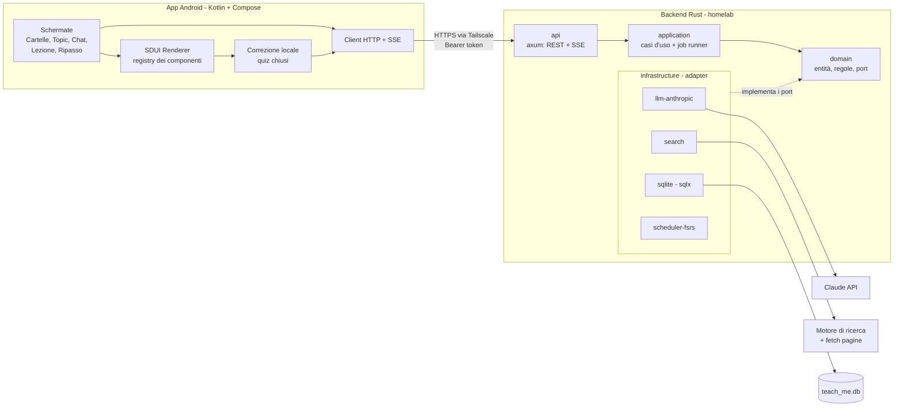

### Regola delle dipendenze (clean architecture)

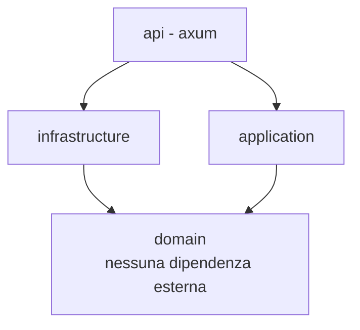

- `domain` non conosce axum, sqlx, Anthropic. Contiene entità, regole (es. validazione dei quiz) e i **port** come trait.
- `application` orchestra i casi d'uso usando solo i trait.
- `infrastructure` implementa i trait.
- `api` è il punto di composizione: costruisce gli adapter e li inietta (composition root).

### Port del dominio

| Port | Responsabilità | Adapter MVP | Adapter futuri |
|---|---|---|---|
| `LlmProvider` | messaggi, tool calling, output strutturato, streaming, capability | Anthropic | OpenAI-compatible (OpenAI, OpenRouter, locali) |
| `SearchProvider` | cerca sul web e restituisce risultati | da scegliere (sezione 11) | altri motori |
| `PageFetcher` | scarica e ripulisce il testo di una pagina | reqwest + estrazione testo | — |
| `ReviewScheduler` | calcola il prossimo ripasso | FSRS | — |
| `*Repository` | persistenza di ogni aggregato | SQLite | Postgres |
| `Clock`, `IdGenerator` | tempo e id, per test deterministici | sistema | — |

Il modello da usare si configura **per ruolo dell'agente**: ad esempio un modello forte per planner e generator, uno economico per il grader. Così si ottimizzano i costi, e in futuro si può usare un modello locale per i ruoli semplici.

## 4. Gli agenti

Invece di un solo prompt gigante come nella skill, ci sono ruoli specializzati. Ognuno riceve **solo il contesto che gli serve** e risponde con **output strutturato**.

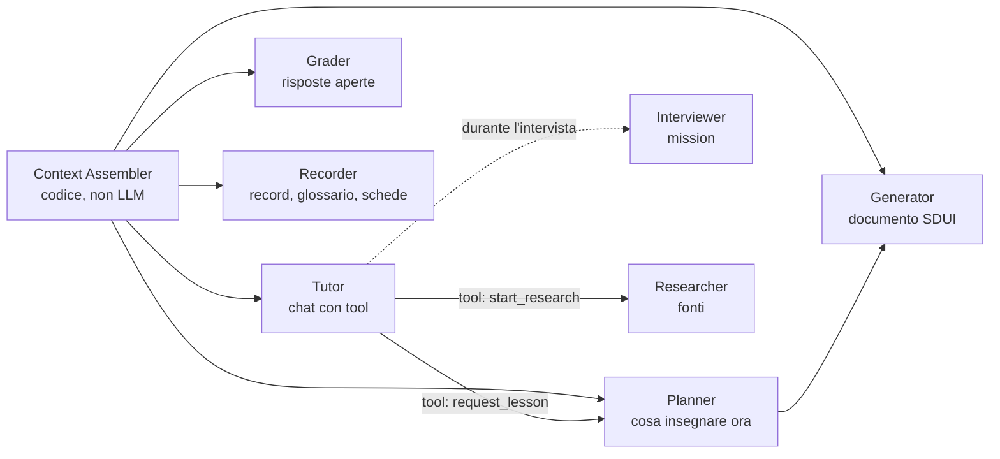

| Ruolo | Input | Output strutturato |
|---|---|---|
| **Tutor** | chat, mission, preferenze, record attivi | testo + tool call (`save_mission_draft`, `save_preference`, `start_research`, `request_lesson`, `propose_mission_change`) |
| **Interviewer** | risposte dell'utente | `MissionDraft` (why, starting_point, success, constraints, out_of_scope) |
| **Researcher** | mission, risultati di ricerca, pagine scaricate | `Resource[]` con tipo, annotazione e "use for" |
| **Planner** | mission, record, glossario, lezioni precedenti, fonti | `LessonPlan` (obiettivo unico, prerequisiti, concetti, fonte primaria, tipi di esercizio) |
| **Generator** | `LessonPlan`, spec del catalogo, glossario, fonti | `LessonDocument` (JSON SDUI) |
| **Grader** | domanda, rubrica, risposta | `Grade` (corretto/parziale/errato, feedback, misconcezione rilevata) |
| **Recorder** | tentativi della lezione, record esistenti | `LearningRecord[]`, `GlossaryTerm[]`, `ReviewCard[]` |

Il **Context Assembler** è codice deterministico: sceglie cosa mettere nel prompt (mission, solo i record attivi, il glossario del Topic, le preferenze) invece di far rileggere tutto all'agente.

## 5. Ciclo di vita di un Topic

```mermaid
stateDiagram-v2
    [*] --> New: crea Topic
    New --> Interviewing: primo messaggio
    Interviewing --> MissionProposed: Interviewer ha abbastanza info
    MissionProposed --> Interviewing: utente corregge
    MissionProposed --> Researching: utente conferma
    Researching --> Ready: fonti salvate
    Ready --> Ready: lezioni, chat, ripassi
    Ready --> Ready: cambio di mission (bozza e conferma, stato invariato; vedi contracts/mission.md)
```

Regola ereditata dalla skill: **nessuna lezione senza mission confermata.**

## 6. Catalogo componenti v1

Ogni blocco ha `id` (stabile, serve per tentativi e feedback) e `type`; la compatibilità è data da `catalog_version` del documento (contratto completo: `docs/contracts/sdui.md`).

| Tipo | Uso | Correzione |
|---|---|---|
| `heading` | titolo di sezione | — |
| `paragraph` | testo con markdown inline (grassetto, corsivo, `code`, link) e citazioni `[^res_id]` | — |
| `callout` | info / tip / warning | — |
| `code` | snippet con linguaggio | — |
| `glossary_term` | definizione di un termine del glossario, tappabile | — |
| `quiz_single` | scelta singola | locale |
| `quiz_multi` | scelta multipla | locale |
| `fill_blank` | completa la frase | locale (match normalizzato) |
| `order_steps` | metti in ordine | locale |
| `flashcard` | domanda → rivela → autovalutazione | locale |
| `open_answer` | risposta libera con rubrica nascosta | backend (Grader) |
| `checklist` | passi da fare nel mondo reale | autodichiarata |
| `primary_source` | la fonte principale consigliata | — |
| `lesson_link` | link a un'altra lezione | — |
| `ask_agent` | "hai dubbi? chiedi al Tutor", apre la chat con il contesto della lezione | — |
| `missing_component` | componente desiderato + `fallback` di blocchi esistenti | — |

### Regole verificate dal Validator (codice, non prompt)

- Lo JSON rispetta lo schema del catalogo e usa solo tipi esistenti.
- Quiz: opzioni con **lo stesso numero di parole** (tolleranza configurabile); la posizione della risposta giusta varia tra le domande della lezione.
- Ogni `[^res_id]` punta a una fonte esistente del Topic.
- Ci sono esattamente un `primary_source` e almeno un `ask_agent`.
- La lezione ha almeno un esercizio con feedback (vincolo "single tangible win").
- Lunghezza massima (la lezione deve restare corta).
- I termini usati in `glossary_term` esistono nel glossario o sono nuovi e dichiarati.

## 7. Flussi

### 7.1 Creazione del Topic e intervista sulla mission

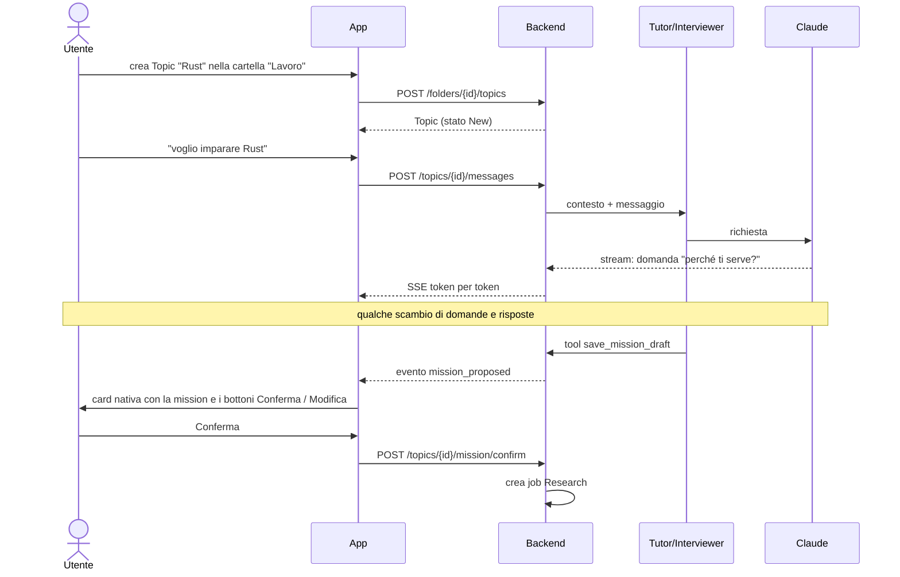

### 7.2 Ricerca delle fonti

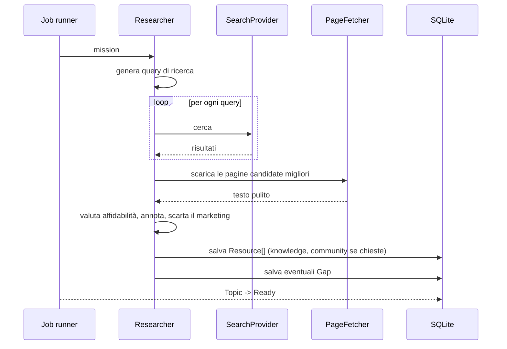

### 7.3 Generazione di una lezione

È l'operazione più lunga (decine di secondi): per questo è un **job asincrono**. L'app vede l'avanzamento via SSE.

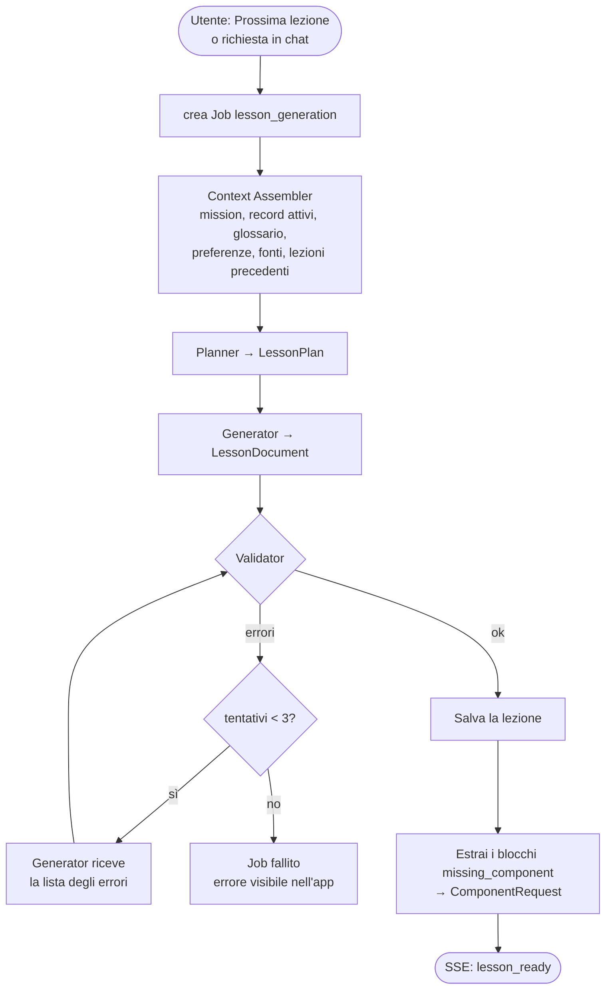

### 7.4 Svolgimento della lezione

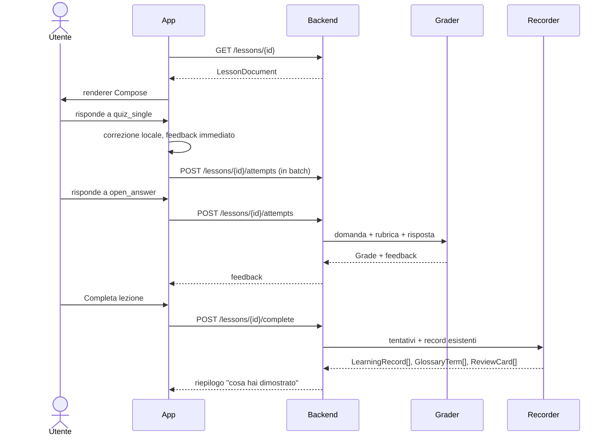

Il Recorder segue le regole della skill: **la copertura non è apprendimento**. Se un concetto è stato solo spiegato ma non dimostrato in un esercizio, non diventa un record né una scheda. Una misconcezione corretta invece genera sempre un record.

### 7.5 Ripasso FSRS

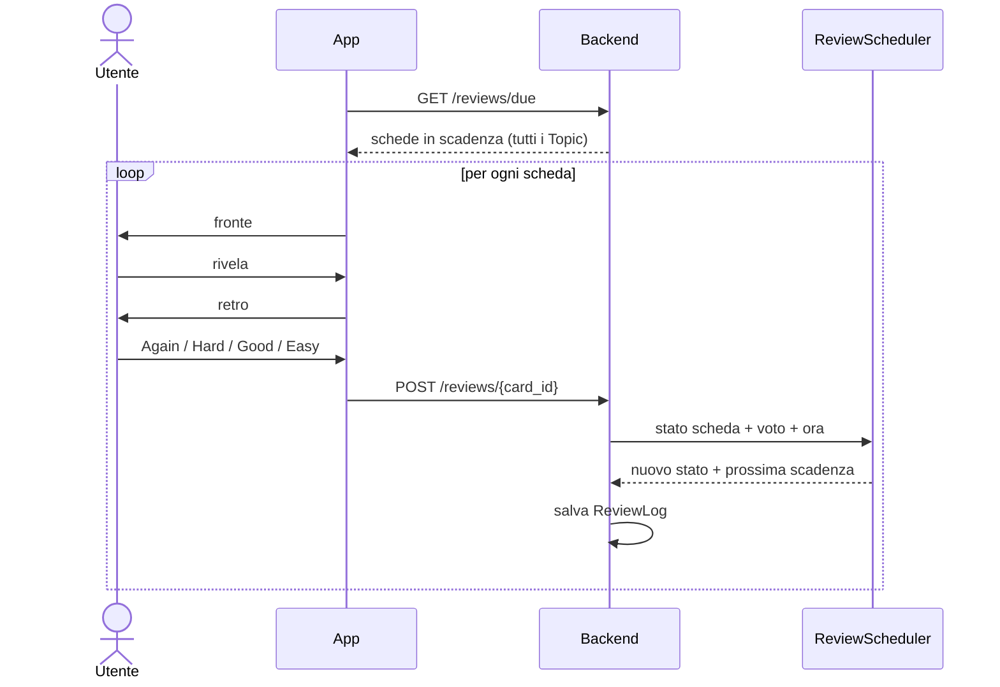

Le schede nascono dal Recorder (sezione 7.4) e sono legate al termine o al record da cui derivano. Se un record viene superato (`superseded`), le sue schede vengono sospese.

### 7.6 Monitoraggio dei componenti mancanti

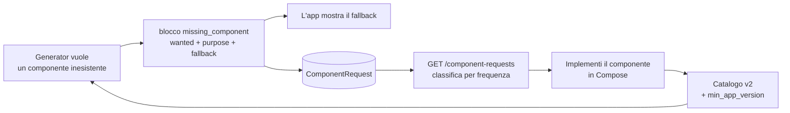

Nell'MVP il raggruppamento è per nome esatto di `wanted`; il clustering semantico è fuori dall'MVP.

## 8. Modello dati

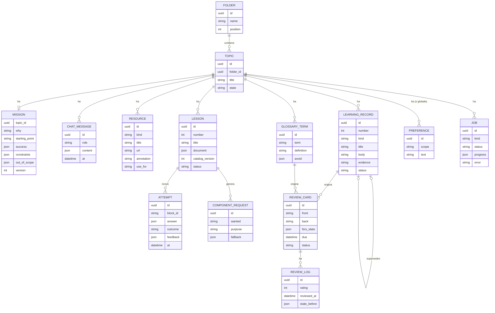

`LessonDocument` si salva come JSON insieme alla `catalog_version` con cui è stato generato: così le lezioni vecchie restano leggibili quando il catalogo evolve.

## 9. API (bozza)

| Metodo | Path | Scopo |
|---|---|---|
| GET/POST | `/folders` | lista / crea cartelle |
| PATCH/DELETE | `/folders/{id}` | rinomina / elimina |
| GET/POST | `/folders/{id}/topics` | lista / crea Topic |
| GET/PATCH/DELETE | `/topics/{id}` | dettaglio / modifica / elimina |
| GET/POST | `/topics/{id}/messages` | chat (la risposta arriva via SSE) |
| GET | `/topics/{id}/events` | stream SSE: token, job, eventi di mission |
| GET | `/topics/{id}/mission` | mission corrente |
| POST | `/topics/{id}/mission/confirm` | conferma della bozza |
| GET | `/topics/{id}/resources` | fonti |
| GET | `/topics/{id}/glossary` | glossario |
| GET | `/topics/{id}/learning-records` | record |
| POST | `/topics/{id}/lessons` | richiede la prossima lezione (crea un job) |
| GET | `/topics/{id}/lessons` | lista delle lezioni |
| GET | `/lessons/{id}` | documento SDUI |
| POST | `/lessons/{id}/attempts` | tentativi (batch) |
| POST | `/lessons/{id}/complete` | chiude la lezione, avvia il Recorder |
| GET | `/reviews/due` | schede da ripassare oggi |
| POST | `/reviews/{card_id}` | voto FSRS |
| GET | `/component-requests` | backlog dei componenti mancanti |
| GET | `/catalog` | catalogo e versione supportata dal backend |

## 10. Schermate Android dell'MVP

> **Target primario: tablet in orizzontale** (window size class expanded), telefono in secondo piano: vedi `docs/adr/0003-tablet-landscape-first.md`. Su expanded Home → Cartella → Argomento è un layout list-detail a più pannelli; il diagramma sotto descrive la navigazione logica, valida anche per compact.

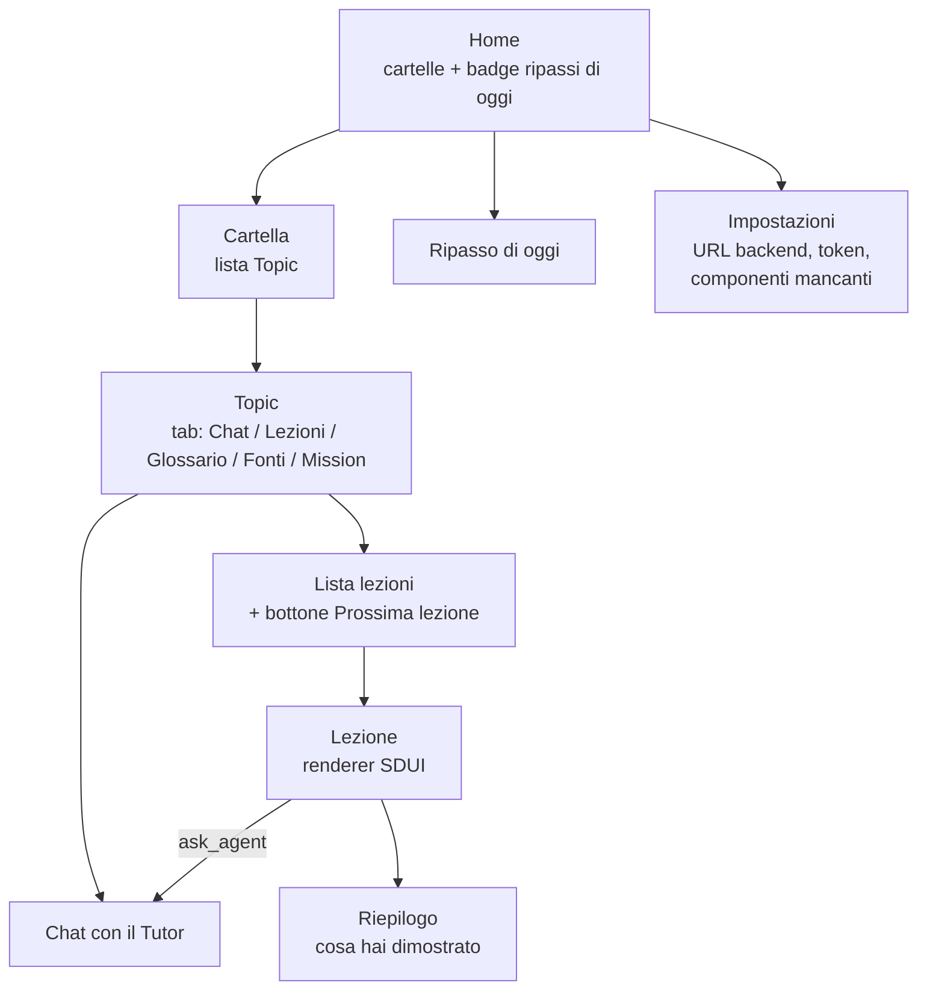

Stack proposto: Kotlin, Jetpack Compose, kotlinx.serialization (i blocchi sono una `sealed class` polimorfica, e un tipo sconosciuto diventa automaticamente `Unknown` → fallback), Ktor client per HTTP e SSE, Koin o Hilt per la DI.

## 11. Decisioni aperte

Tutte decise il 2026-11-08: vedi `docs/adr/0005-mvp-open-decisions.md` (D1 ricerca con gli strumenti web lato server di Anthropic; D2 schede solo fronte/retro; D3 lezioni in italiano con termini tecnici originali; D4 FSRS con un crate esistente dietro `ReviewScheduler`).
